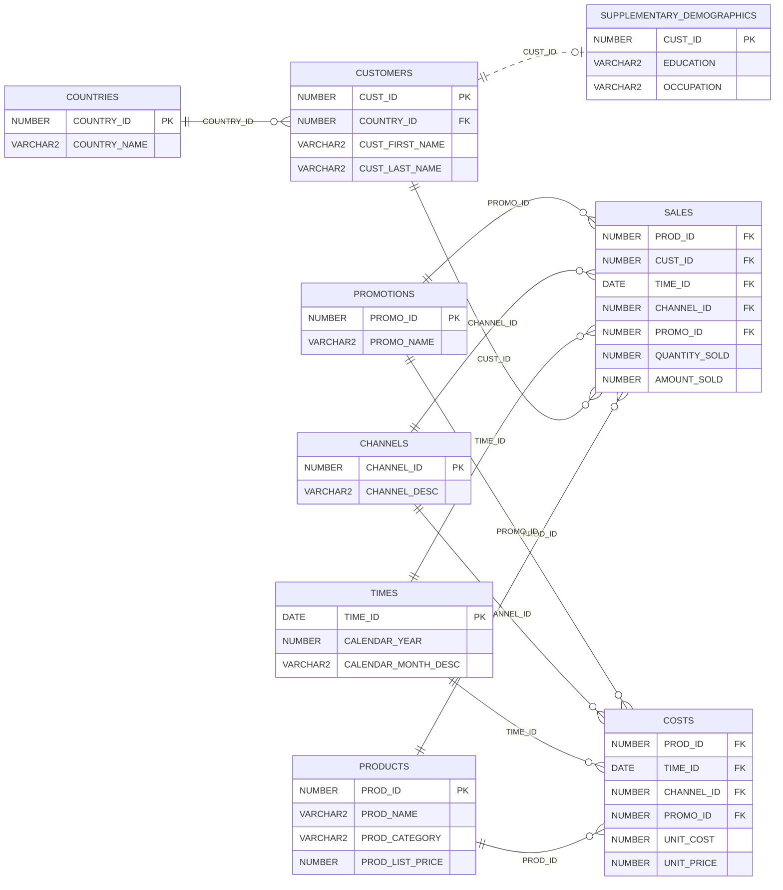

# SELECT AI 샘플 데이터 구성

[SELECT AI 환경구성](SelectAiConfigure.md)의 패키지·Wallet·ACL 설정과 [실습 계정 관리의 데이터 준비](lab_admin.md#4-실습-계정별-데이터-준비)를 완료한 후, 실습 PDB `orclpdb2`에 본인의 실습 계정(`lab00`~`lab19`)으로 접속하여 실행합니다. 이 문서는 SH 스키마 구조와 데이터 설명, Annotation 등록·확인을 다룹니다.

Annotation은 실습 데이터를 준비할 때 함께 등록합니다. [SELECT AI 예제](SelectAiExample.md)의 Part 1은 `annotations=false`로 Annotation을 LLM에 전달하지 않고, Part 2는 `annotations=true`로 전달하므로 같은 데이터에서 효과를 비교할 수 있습니다.

## 1. 실습 데이터: SH 스키마

`SH.PRODUCTS`는 Oracle의 판매 이력 샘플 스키마에서 **상품 기준정보**를 관리하는 테이블입니다. 상품별로 한 행을 저장하며, 기본키는 `PROD_ID`입니다. 상품명·설명, 대분류·소분류, 가격, 공급자와 상태 등의 정보를 포함합니다.

실습에서는 `PRODUCTS` 단일 테이블 질문과 `SALES`, `TIMES`, `CUSTOMERS`, `COUNTRIES`를 조인하는 질문을 함께 사용합니다. 두 프로파일의 `object_list`에는 각 실습 계정에 복사한 SH의 전체 9개 테이블을 명시합니다.

### 테이블 관계 구조도

다음은 SH의 전체 9개 테이블과 연결 키를 표시한 구조도입니다. 각 테이블에는 주요 컬럼만 표시했습니다.



`PK`는 기본키, `FK`는 외래키입니다. 관계선은 부모 테이블의 한 행에 자식 테이블의 여러 행이 연결될 수 있음을 나타냅니다.

`SUPPLEMENTARY_DEMOGRAPHICS`는 고객의 학력·직업 등 부가정보입니다. 고객과의 점선은 `CUST_ID`를 통한 논리적 연결이며, 원본 SH 정의에는 이 관계의 외래키가 없습니다.

`SALES`는 판매금액·수량, `COSTS`는 단위 원가·가격을 관리합니다. 상품·일자·채널·프로모션을 기준으로 연결되며, `SALES`는 고객 정보와도 연결됩니다. 고객의 국가는 `CUSTOMERS`를 통해 확인합니다.

### 주요 데이터 구조

| 구분 | 주요 컬럼 | 내용 |
|---|---|---|
| 상품 식별 | `PROD_ID`, `PROD_NAME`, `PROD_DESC` | 상품 ID, 상품명, 상세 설명 |
| 상품 분류 | `PROD_CATEGORY`, `PROD_SUBCATEGORY` | 상품 대분류와 소분류 |
| 분류 부가정보 | `PROD_CATEGORY_ID`, `PROD_SUBCATEGORY_ID`, `PROD_CATEGORY_DESC`, `PROD_SUBCATEGORY_DESC` | 분류별 ID와 설명 |
| 가격 | `PROD_LIST_PRICE`, `PROD_MIN_PRICE` | 상품 정가와 최저 가격 |
| 공급자·상태 | `SUPPLIER_ID`, `PROD_STATUS` | 공급자 ID와 상품 상태 |
| 상품 속성 | `PROD_WEIGHT_CLASS`, `PROD_UNIT_OF_MEASURE`, `PROD_PACK_SIZE` | 중량 등급, 측정 단위, 포장 크기 |
| 이력 관리 | `PROD_SRC_ID`, `PROD_EFF_FROM`, `PROD_EFF_TO`, `PROD_VALID` | 원본 식별자, 유효기간, 유효성 표시 |

### 데이터 내용과 활용

현재 Oracle 공개 샘플에는 야구용품 등의 상품이 포함됩니다. 예를 들어 상품 `129`는 `Pro Maple Bat`이며, 대분류는 `Baseball`, 소분류는 `Bats`, 정가는 `192.99`입니다. 데이터를 직접 조회하여 확인하십시오.

이 데이터를 이용해 **분류별 상품 수, 상품 가격 비교, 조건에 맞는 상품 검색**을 실습합니다. 특히 한국어 질문의 “상품명”, “대분류”, “정가” 같은 표현을 해당 컬럼에 연결하도록 Annotation으로 업무 의미를 보완할 수 있습니다.

`PRODUCTS`의 가격은 상품 기준정보이며, 실제 판매금액과 판매수량은 `SH.SALES`에서 관리합니다. 두 테이블은 `PROD_ID`로 연결됩니다.

참고: [Oracle SH 테이블 정의](https://docs.oracle.com/en/database/oracle/oracle-database/26/comsc/SH-sample-schema-table-descriptions.html), [공식 테이블 생성 스크립트](https://github.com/oracle-samples/db-sample-schemas/blob/main/sales_history/sh_create.sql), [공식 샘플 데이터](https://github.com/oracle-samples/db-sample-schemas/blob/main/sales_history/sh_populate.sql)

## 2. 실습 계정별 Annotation 등록

Annotation에 테이블·컬럼의 업무 의미와 조인 관계를 설명하여 **자연어 질문의 의도에 맞는 SQL을 생성하도록 보완**합니다. 아래의 “야구용품”, “고가 상품”, “연도”, “국가”, “매출액” 정의는 예제 질문에서 사용할 실습 규칙입니다.

| 업무 용어 | 실습 정의 |
|---|---|
| 대분류 | `PRODUCTS.PROD_CATEGORY` |
| 야구용품 | `PRODUCTS.PROD_CATEGORY = 'Baseball'` |
| 고가 상품 | `PRODUCTS.PROD_LIST_PRICE >= 100` |
| 연도 | `TIMES.CALENDAR_YEAR`의 달력 연도 |
| 국가 | 고객이 속한 국가의 `COUNTRIES.COUNTRY_NAME` |
| 매출액 | `SALES.AMOUNT_SOLD`의 합계 |

`AI_DESCRIPTION`과 `AI_MEANING`은 이 실습에서 정한 Annotation 이름입니다. 테이블에는 업무 역할·관계 설명을, 주요 컬럼에는 용어와 계산 기준을 등록합니다. Annotation은 데이터를 변경하거나 SQL 조건을 강제하는 기능이 아니라 LLM에 제공할 메타데이터입니다.

데이터를 준비한 본인의 실습 계정에 접속한 상태에서 아래 구문을 최초 한 번 실행합니다. Annotation은 현재 접속한 계정 소유의 테이블에 등록됩니다. 동일한 대상에 같은 이름의 Annotation이 이미 있으면 `ADD` 대신 `REPLACE`로 값을 수정합니다.

### 2.1 테이블별 역할과 관계

```sql
ALTER TABLE products ANNOTATIONS (
  ADD AI_DESCRIPTION '상품 기준정보. 상품당 한 행이며 기본키는 PROD_ID이다. SALES와 COSTS의 PROD_ID가 이 상품을 참조한다. 상품 수는 PRODUCTS의 행 수로 집계한다.'
);

ALTER TABLE sales ANNOTATIONS (
  ADD AI_DESCRIPTION '판매 이력. 상품별로 여러 판매 행이 존재한다. PROD_ID로 PRODUCTS, CUST_ID로 CUSTOMERS, TIME_ID로 TIMES, CHANNEL_ID로 CHANNELS, PROMO_ID로 PROMOTIONS와 조인한다. 매출액은 AMOUNT_SOLD의 합계이며 상품 정가와 구분한다.'
);

ALTER TABLE costs ANNOTATIONS (
  ADD AI_DESCRIPTION '상품의 단위 원가와 단위 가격 정보. PROD_ID로 PRODUCTS, TIME_ID로 TIMES, CHANNEL_ID로 CHANNELS, PROMO_ID로 PROMOTIONS와 연결한다. SALES와 결합할 때는 PROD_ID, TIME_ID, CHANNEL_ID, PROMO_ID를 모두 사용한다.'
);

ALTER TABLE customers ANNOTATIONS (
  ADD AI_DESCRIPTION '고객 기준정보. 기본키는 CUST_ID이다. SALES.CUST_ID가 고객을 참조하며, COUNTRY_ID로 COUNTRIES와 연결하여 고객의 국가를 확인한다.'
);

ALTER TABLE countries ANNOTATIONS (
  ADD AI_DESCRIPTION '국가 기준정보. 기본키는 COUNTRY_ID이고 국가명은 COUNTRY_NAME이다. 국가별 매출은 COUNTRIES에서 CUSTOMERS를 거쳐 SALES로 연결하여 집계한다.'
);

ALTER TABLE times ANNOTATIONS (
  ADD AI_DESCRIPTION '일자 기준정보. 기본키 TIME_ID는 날짜이다. SALES.TIME_ID와 COSTS.TIME_ID가 참조한다. 별도 언급 없는 연도별 집계는 CALENDAR_YEAR를 사용하며 회계연도와 구분한다.'
);

ALTER TABLE channels ANNOTATIONS (
  ADD AI_DESCRIPTION '판매 채널 기준정보. 기본키는 CHANNEL_ID이고 채널명은 CHANNEL_DESC이다. SALES와 COSTS의 CHANNEL_ID가 참조한다.'
);

ALTER TABLE promotions ANNOTATIONS (
  ADD AI_DESCRIPTION '판매 프로모션 기준정보. 기본키는 PROMO_ID이고 프로모션명은 PROMO_NAME이다. SALES와 COSTS의 PROMO_ID가 참조한다.'
);

ALTER TABLE supplementary_demographics ANNOTATIONS (
  ADD AI_DESCRIPTION '고객 부가정보. CUST_ID가 기본키이며 CUSTOMERS.CUST_ID와 논리적으로 연결한다. EDUCATION은 학력, OCCUPATION은 직업이다. 외래키는 별도로 정의하지 않는다.'
);
```

### 2.2 예제 질문에 사용할 주요 컬럼

```sql
ALTER TABLE products MODIFY prod_id ANNOTATIONS (
  ADD AI_MEANING '상품 ID. PRODUCTS의 기본키이며 SALES.PROD_ID와 연결하는 조인 키이다.'
);
ALTER TABLE products MODIFY prod_name ANNOTATIONS (
  ADD AI_MEANING '상품명. 상품 이름을 요청하면 이 컬럼을 사용한다.'
);
ALTER TABLE products MODIFY prod_category ANNOTATIONS (
  ADD AI_MEANING '상품 대분류. 야구용품은 PROD_CATEGORY = ''Baseball''인 상품이다. 대분류별 상품 수는 이 컬럼으로 그룹화하여 COUNT(*)로 집계한다.'
);
ALTER TABLE products MODIFY prod_list_price ANNOTATIONS (
  ADD AI_MEANING '상품 정가. 이 실습에서 고가 상품은 PROD_LIST_PRICE >= 100인 상품이다. 정가는 실제 매출액이 아니다.'
);

ALTER TABLE sales MODIFY prod_id ANNOTATIONS (
  ADD AI_MEANING '판매된 상품 ID. SALES.PROD_ID = PRODUCTS.PROD_ID로 조인한다. 야구용품과 고가 상품 조건은 PRODUCTS에서 적용한다.'
);
ALTER TABLE sales MODIFY cust_id ANNOTATIONS (
  ADD AI_MEANING '구매 고객 ID. SALES.CUST_ID = CUSTOMERS.CUST_ID로 조인한다.'
);
ALTER TABLE sales MODIFY time_id ANNOTATIONS (
  ADD AI_MEANING '판매 일자. SALES.TIME_ID = TIMES.TIME_ID로 조인하여 연도를 확인한다.'
);
ALTER TABLE sales MODIFY amount_sold ANNOTATIONS (
  ADD AI_MEANING '해당 판매 행의 매출액. 연도별 또는 국가별 매출액은 이 컬럼을 SUM으로 집계한다. PROD_LIST_PRICE를 합산하거나 판매수량을 다시 곱하지 않는다.'
);

ALTER TABLE times MODIFY time_id ANNOTATIONS (
  ADD AI_MEANING '일자 기준정보의 기본키. SALES.TIME_ID와 연결한다.'
);
ALTER TABLE times MODIFY calendar_year ANNOTATIONS (
  ADD AI_MEANING '달력 연도. 연도별 매출액 질문에서는 이 컬럼으로 그룹화한다.'
);

ALTER TABLE customers MODIFY cust_id ANNOTATIONS (
  ADD AI_MEANING '고객 ID. CUSTOMERS의 기본키이며 SALES.CUST_ID와 연결한다.'
);
ALTER TABLE customers MODIFY country_id ANNOTATIONS (
  ADD AI_MEANING '고객이 속한 국가 ID. CUSTOMERS.COUNTRY_ID = COUNTRIES.COUNTRY_ID로 조인한다.'
);

ALTER TABLE countries MODIFY country_id ANNOTATIONS (
  ADD AI_MEANING '국가 ID. COUNTRIES의 기본키이며 CUSTOMERS.COUNTRY_ID와 연결한다.'
);
ALTER TABLE countries MODIFY country_name ANNOTATIONS (
  ADD AI_MEANING '국가명. 국가별 매출액 질문에서는 고객이 속한 국가를 이 컬럼으로 그룹화한다.'
);
```

## 3. Annotation 등록 확인

현재 접속한 실습 계정 소유의 Annotation을 확인합니다. `COLUMN_NAME`이 NULL이면 테이블 수준, 값이 있으면 해당 컬럼 수준의 Annotation입니다.

```sql
SELECT object_name, column_name, annotation_name, annotation_value
FROM   user_annotations_usage
WHERE  object_type = 'TABLE'
AND    annotation_name IN ('AI_DESCRIPTION', 'AI_MEANING')
AND    object_name IN (
  'PRODUCTS', 'SALES', 'COSTS', 'CUSTOMERS', 'COUNTRIES',
  'TIMES', 'CHANNELS', 'PROMOTIONS', 'SUPPLEMENTARY_DEMOGRAPHICS'
)
ORDER BY object_name, column_name NULLS FIRST, annotation_name;
```

등록 후 [SELECT AI 예제의 실행 전 확인](SelectAiExample.md#실행-전-확인)으로 이동합니다. Part 1과 Part 2에서 동일한 질문을 사용하고, `annotations=false`와 `annotations=true` 프로파일의 결과를 비교합니다.

참고: [Oracle Annotation 구문](https://docs.oracle.com/en/database/oracle/oracle-database/26/sqlrf/annotations_clause.html), [Annotation 조회 뷰](https://docs.oracle.com/en/database/oracle/oracle-database/26/refrn/ALL_ANNOTATIONS_USAGE.html), [Select AI의 Annotation 활용](https://docs.oracle.com/en/database/oracle/oracle-database/26/selai/generate-and-improve-sql-queries.html)

실습 종료 후 데이터·테이블 정리는 [실습 계정 관리의 클린징](lab_admin.md#5-실습-데이터테이블-클린징)에서 진행합니다.
