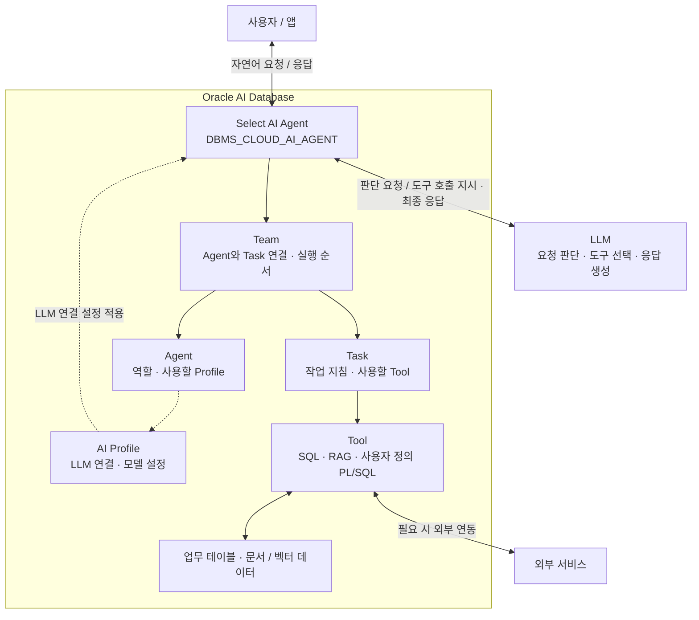
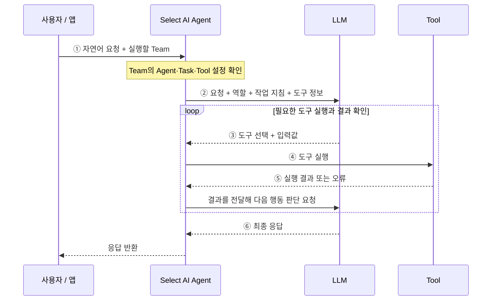

# Oracl Select AI Agent 소개

> **적용 환경**: 이 폴더는 온프레미스 Oracle AI Database 26ai를 대상으로 합니다. 사용 RU의 지원 범위와 패키지·권한·네트워크 준비는 [공통 환경 구성](./OnPremises_Setup.md)에서 확인합니다.

## Select AI Agent란?

**Select AI Agent는 Oracle AI Database에서 AI 에이전트를 구성하고 실행하는 프레임워크**입니다. 사용자가 지정한 LLM을 활용해 자연어 요청을 해석하고, SQL 조회·문서 검색·PL/SQL 호출 등의 도구를 사용해 작업을 수행합니다.

에이전트는 **ReAct(Reasoning and Acting)** 방식으로 요청을 판단하고, 도구를 실행하고, 결과를 확인하는 과정을 반복합니다. 에이전트와 작업·도구·팀은 `DBMS_CLOUD_AI_AGENT` 패키지로 생성하고 관리합니다. [Oracle 공식 개요](https://docs.oracle.com/en/database/oracle/oracle-database/26/selai/select-ai-agent-concepts.html)

## Select AI Agent 구조

다음은 이 폴더의 실습에서 사용하는 **Agent와 Task를 연결한 Team의 개념 구조**입니다.



**Team**은 실행할 Agent와 Task를 연결합니다. **Agent**의 역할과 **Task**의 작업 지침을 바탕으로 LLM이 사용할 도구와 입력값을 판단하고, 데이터베이스가 도구를 실행합니다. 그림의 연결선은 설정 참조와 호출 관계를 간략히 나타냅니다.

| 컴포넌트 | 간략한 설명 |
| --- | --- |
| **DBMS_CLOUD_AI_AGENT** | Agent·Task·Tool·Team의 생성·관리와 팀 실행을 제공하는 PL/SQL 패키지입니다. |
| **Team(팀)** | 하나 이상의 Agent와 Task를 묶고 실행 흐름을 정의합니다. 사용자 요청을 처리하는 실행 단위입니다. |
| **Agent(에이전트)** | 역할(`role`)과 AI 프로파일(`profile_name`)을 지정해 작업을 수행할 주체를 정의합니다. |
| **Task(작업)** | 수행할 작업과 응답 지침(`instruction`), 사용할 도구 목록(`tools`)을 정의합니다. |
| **Tool(도구)** | SQL 조회, RAG 검색, 사용자 정의 PL/SQL 호출 등 실제 작업을 수행하고 결과를 반환합니다. |
| **AI Profile** | `DBMS_CLOUD_AI`로 관리하며 사용할 LLM과 연결 정보를 지정합니다. SQL·RAG 도구에는 별도의 프로파일을 지정할 수도 있습니다. |
| **LLM** | 요청과 작업 지침을 바탕으로 다음 행동을 판단하고, 도구 실행 결과를 참고해 응답을 생성합니다. |

객체별 설정은 [DBMS_CLOUD_AI_AGENT 공식 문서](https://docs.oracle.com/en/database/oracle/oracle-database/26/selai/select-ai-agent-pl-sql-package.html)를 참고합니다.

LLM은 프로파일에 지정한 엔드포인트에서 동작합니다. 온프레미스 DB에 연결한 LLM은 내부 서버 또는 외부 서비스일 수 있습니다. 메타데이터와 요청, 도구 실행 결과가 해당 LLM에 전달될 수 있으며, 실제 데이터 조회와 PL/SQL 실행은 데이터베이스에서 처리합니다.

## Select AI Agent 실행 흐름

다음은 하나의 Agent와 Task를 실행할 때의 기본 흐름입니다. 여러 Agent로 구성한 Team은 정의된 실행 방식에 따라 작업을 이어갑니다.



1. **요청 입력**: 사용자가 자연어 요청을 전달하고 실행할 Team을 지정합니다.
2. **실행 정보 구성**: Team에 연결된 Agent의 역할, Task의 지침과 도구 정보를 요청에 함께 반영합니다.
3. **도구 선택**: LLM이 작업에 필요한 도구와 입력값을 판단합니다.
4. **도구 실행**: 데이터베이스가 선택된 도구를 호출해 SQL 조회, 문서 검색 또는 PL/SQL 작업을 수행합니다.
5. **결과 확인**: 도구 결과나 오류를 관찰 결과(Observation)로 전달합니다. LLM은 이를 바탕으로 추가 도구 호출 또는 응답 생성을 판단합니다.
6. **응답 반환**: 작업 결과를 바탕으로 최종 응답을 사용자에게 제공합니다.

도구 호출 횟수와 순서는 요청과 실행 결과에 따라 달라집니다. 대화 문맥을 이어가려면 대화 설정과 `conversation_id`를 사용하며, 사용자 확인이 필요한 작업은 설정에 따라 질문을 반환하고 후속 입력을 기다릴 수 있습니다. [Oracle 실행 예제](https://docs.oracle.com/en/database/oracle/oracle-database/26/selai/examples-using-select-ai-agent1.html)

## Select AI Agent 실행 방법

Agent·Task·Tool·Team을 생성한 후, 현재 세션에 Team을 지정하고 `SELECT AI AGENT`로 요청합니다. 아래의 `MY_AGENT_TEAM`은 미리 생성한 팀 이름으로 변경합니다.

```sql
EXEC DBMS_CLOUD_AI_AGENT.SET_TEAM('MY_AGENT_TEAM');

SELECT AI AGENT 부서별 직원 수를 알려줘;

-- 세션의 팀 지정 해제
EXEC DBMS_CLOUD_AI_AGENT.CLEAR_TEAM;
```

- **SET_TEAM**: 현재 세션에서 사용할 에이전트 팀을 지정합니다.
- **SELECT AI AGENT**: 지정한 팀으로 자연어 요청을 처리합니다.
- **CLEAR_TEAM**: 세션의 팀 지정을 해제합니다. 생성된 팀 객체를 삭제하지는 않습니다.

애플리케이션이나 PL/SQL에서는 `DBMS_CLOUD_AI_AGENT.RUN_TEAM`에 팀 이름과 요청을 전달할 수도 있습니다. [Oracle 패키지 문서](https://docs.oracle.com/en/database/oracle/oracle-database/26/selai/select-ai-agent-pl-sql-package.html)

객체 생성부터 실행까지의 전체 스크립트는 [SQL·RAG 도구 기본 예제](./Oracle26ai%20SelectAI%20Agent.md)를 참고합니다. 다른 실습은 [문서 목록](./README.md)에서 확인할 수 있습니다.

## 온프레미스에서 사용할 도구

| 도구 | 구성과 사용 범위 |
| --- | --- |
| SQL | NL2SQL용 프로파일의 대상 테이블·뷰를 조회합니다. object_list와 DB 권한을 함께 설정합니다. |
| RAG | Select AI 벡터 인덱스와 임베딩 모델을 이용해 문서 근거를 검색합니다. |
| 사용자 정의 PL/SQL | function 속성에 등록한 저장 함수·프로시저를 호출합니다. 내장 tool_type = function을 지정하는 방식은 아닙니다. |
| WEBSEARCH·NOTIFICATION | 지원 RU에서 사용 가능하지만 검색 제공자나 이메일·Slack의 별도 서비스·인증·네트워크 설정이 필요합니다. 폐쇄망에서 자동으로 이용할 수 있는 기능은 아닙니다. |

MCP 서버는 이 예제의 필수 구성 요소가 아닙니다. 26ai 문서에 소개된 Autonomous AI Database MCP Server를 온프레미스에 기본 제공되는 서비스로 해석하지 않습니다. [공식 개념 문서](https://docs.oracle.com/en/database/oracle/oracle-database/26/selai/select-ai-agent-concepts.html)
