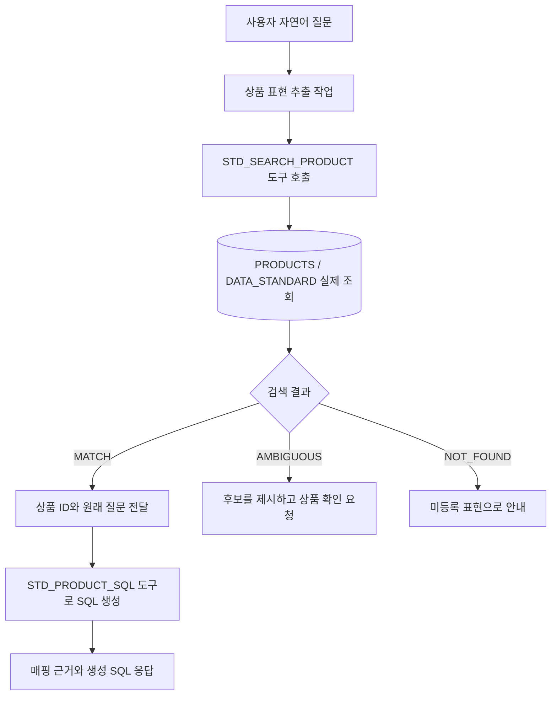

# 기준정보 테이블로 상품 표현을 해석하는 Select AI Agent

사용자가 상품의 한글명이나 동의어로 질문하면 **실제 기준정보를 먼저 검색해 상품 ID를 확인하고, 그 ID를 조건으로 SQL을 생성**하는 실습입니다. 상품별 한글명과 동의어는 `DATA_STANDARD`의 데이터로 관리하며, 전체 목록을 Annotation에 나열하지 않습니다.

**확인 상태: 2026-11-18.** `gemma2:9b` 일반 채팅과 실제 검색 도구 호출은 성공했습니다. 두 번의 전체 Agent 실행에서는 검색 도구가 각각 한 번 완료됐지만 작업 0이 종료되지 않아 SQL 작업으로 넘어가지 못했습니다. 짧은 LLM 요청이 반복됐으며 해당 DB SQL을 취소하자 Ollama 반복 로그가 멈췄습니다. CPU 추론 지연으로 완료를 기다리는 상태가 아니라 검색 이후 작업 종료를 진단하는 상태입니다. 아래 전체 시나리오는 최종 SQL 생성까지 성공한 예제가 아니며, 기대 SQL·JSON은 비교용입니다.

## 1. 해결하려는 문제

영문 상품명이 저장된 `PRODUCTS`를 한국어로 조회할 때 다음처럼 단순 번역한 SQL이 생성될 수 있습니다.

```sql
-- 질문: 남아공 크리켓 팀 유니폼의 상품 ID와 영문 상품명과 정가를 보여줘.
-- 일반 Select AI + Annotation 실험에서 관찰한 조건
WHERE UPPER(PROD_NAME) LIKE '%SOUTH AFRICA CRICKET TEAM%'
```

해당 상품의 실제 `PROD_NAME`은 `Team shirt`이고, 같은 영문명을 쓰는 상품이 여러 개입니다. 영문명을 추측하는 대신 아래 매핑을 조회해야 합니다.

| PROD_ID | STANDARD_VALUE | TERM_KO | TERM_TYPE |
| --- | --- | --- | --- |
| 41 | Team shirt | 남아프리카공화국 크리켓 대표팀 셔츠 | STANDARD |
| 41 | Team shirt | 남아공 크리켓 팀 유니폼 | SYNONYM |
| 129 | Pro Maple Bat | 프로 메이플 배트 | STANDARD |
| 129 | Pro Maple Bat | 프로 단풍나무 야구방망이 | SYNONYM |
| 130 | Pro Maple Youth Bat | 프로 메이플 유소년 배트 | STANDARD |
| 130 | Pro Maple Youth Bat | 프로 주니어 단풍나무 야구방망이 | SYNONYM |

연결 키는 `PROD_ID`입니다. `STANDARD_VALUE`는 영문명을 대소문자 그대로 복사한 참고값이며, 조인 키가 아닙니다. 새 동의어는 데이터로 추가하고 검색 함수나 Annotation에는 상품별 목록을 추가하지 않습니다.

## 2. Agent 실행 흐름



동일 Agent에 두 작업을 배정한 `sequential` 팀입니다. 첫 작업에는 검색 도구만, 두 번째 작업에는 SQL 도구만 제공하고 `input`으로 앞 작업의 출력을 연결합니다.

| 객체 | 이름 | 역할 |
| --- | --- | --- |
| PL/SQL 함수 | `STD_AGENT_FIND_PRODUCT` | LLM 없이 상품명·동의어를 실제 데이터에서 검색 |
| AI 프로파일 | `STD_PRODUCT_AGENT_PROFILE` | Ollama 연결 및 SQL 대상 `PRODUCTS`, `SALES`, `TIMES` 지정 |
| 검색 도구 | `STD_SEARCH_PRODUCT` | 사용자 정의 PL/SQL 함수 호출 |
| SQL 도구 | `STD_PRODUCT_SQL` | 내장 NL2SQL 기능으로 확인된 ID를 사용하는 SQL 생성 |
| Agent | `STD_PRODUCT_AGENT` | 검색 결과를 근거로 작업 수행 |
| 검색 작업 | `STD_RESOLVE_PRODUCT_TASK` | 원문 상품 표현 추출, 검색 도구 호출, ID 중복 제거 |
| SQL 작업 | `STD_PRODUCT_SQL_TASK` | 검색 결과를 전달받아 SQL 생성 또는 모호함 안내 |
| 팀 | `STD_PRODUCT_TEAM` | 검색 작업 후 SQL 작업 실행 |

이 실습의 프로파일은 `annotations=false`입니다. 이전 실습의 상품 예시나 검색 규칙을 다시 해석하게 하는 대신, 도구의 조회 결과를 SQL 생성에 전달하는 경로를 검증합니다. 기존 Annotation은 변경하지 않습니다. Annotation은 별도로 컬럼 의미와 업무 규칙을 보완할 수 있지만, 동의어 데이터 조회를 대신하지 않습니다.

## 3. 사전 준비

- [온프레미스 공통 환경 구성](../OnPremises_Setup.md)의 패키지, 권한, ACL, Wallet을 준비합니다. 제품명이 26ai여도 실제 RU와 설치된 Agent API를 확인해야 합니다.
- [SH 샘플 데이터 준비](../../01_SelectAI_Intro_Lab/SampleDataConfig.md)에 따라 본인 실습 계정에 `PRODUCTS`, `SALES`, `TIMES`를 준비합니다. 제공하는 한글 매핑은 스포츠용품 상품 72개가 있는 SH 샘플을 기준으로 합니다.
- 같은 계정에 `DATA_STANDARD`가 있어야 합니다. 없다면 다음 절의 준비 스크립트를 실행합니다.
- 함수 생성을 위한 `CREATE PROCEDURE`, `DBMS_CLOUD_AI`와 `DBMS_CLOUD_AI_AGENT` 실행 권한이 필요합니다. 권한 부여는 같은 PDB에서 관리자가 수행합니다.
- UTF-8 SQLcl 또는 한글 문자셋을 맞춘 SQL*Plus를 사용합니다.

```sql
-- 관리자 실행 예시. LAB은 실제 실습 계정으로 변경합니다.
GRANT EXECUTE ON DBMS_CLOUD_AI TO LAB;
GRANT EXECUTE ON DBMS_CLOUD_AI_AGENT TO LAB;
GRANT CREATE PROCEDURE TO LAB;
```

실습 계정이 이미 준비된 경우 위 권한을 다시 부여할 필요는 없습니다. LLM 주소·모델명은 환경에 맞게 지정하며, 일반 채팅 성공이 Agent의 도구 호출 성공을 의미하지는 않습니다.

## 4. 스크립트와 설치 순서

이 폴더를 현재 디렉터리로 두고 실행합니다. `install.sql` 내부의 `@@`는 설치 파일 위치를 기준으로 나머지 스크립트를 찾습니다.

| 파일 | 내용 |
| --- | --- |
| [prepare_data_standard.sql](scripts/prepare_data_standard.sql) | 선택 단계. 테이블 생성 및 72개 상품의 한글명·동의어 총 144행 삽입 |
| [00_precheck.sql](scripts/00_precheck.sql) | 설치된 Agent API, 기준정보, 실습 계정 확인 |
| [01_create_search_function.sql](scripts/01_create_search_function.sql) | 실제 데이터 검색 함수 생성 |
| [03_verify_lookup.sql](scripts/03_verify_lookup.sql) | LLM 없이 검색 함수 직접 검증 |
| [02_create_agent.sql](scripts/02_create_agent.sql) | 프로파일·도구·Agent·작업·팀 생성 |
| [install.sql](scripts/install.sql) | 사전 점검 → 함수 생성 → 함수 검증 → Agent 생성 순서로 실행 |
| [04_run_agent.sql](scripts/04_run_agent.sql) | Agent 요청과 추가 질문 예제 |
| [05_check_profile.sql](scripts/05_check_profile.sql) | 기존 성공 프로파일과 endpoint/model 비교, HTTP 진단 명령 |
| [06_update_connection.sql](scripts/06_update_connection.sql) | 재설치 없이 기존 프로파일의 연결 설정 수정 및 chat 검사 |
| [07_monitor_agent.sql](scripts/07_monitor_agent.sql) | CPU 환경에서 실행 중인 작업·최근 종료 이력 확인 |
| [08_create_minimal_agent.sql](scripts/08_create_minimal_agent.sql) | 진단용 Agent·작업·팀 생성. 검색 도구 하나만 연결 |
| [09_run_minimal_agent.sql](scripts/09_run_minimal_agent.sql) | 동일 프로파일·모델로 최소 검색 Agent를 한 번 실행 |
| [10_inspect_minimal_agent.sql](scripts/10_inspect_minimal_agent.sql) | 최소 실행의 작업·도구 이력과 DBA 세션 식별 방법 |

### 4.1 기준정보가 없는 경우만 준비

```sql
@scripts/prepare_data_standard.sql
```

`DATA_STANDARD`가 이미 있으면 이 단계는 건너뜁니다. 기존 테이블을 삭제하거나 초기화하지 않습니다. 준비 스크립트는 `PROD_ID`와 예상 영문명을 검증하며, 대소문자·앞뒤 공백 차이는 허용하고 저장값은 실제 `PRODUCTS.PROD_NAME`을 그대로 사용합니다. ID가 없거나 다른 상품이 들어 있거나, 한글 매핑이 없는 추가 상품이 있으면 중단합니다.

### 4.2 연결 설정 후 설치

[02_create_agent.sql](scripts/02_create_agent.sql)의 `AGENT_ENDPOINT`를 확인합니다. 현재 실습에서 일반 채팅에 성공한 주소는 `http://service-ollama/v1`입니다. 모델명은 설치 중 입력받으며, 현재 확인된 모델은 `gemma2:9b`입니다. 설치되지 않은 예시 모델을 그대로 지정하지 않습니다.

```sql
@scripts/install.sql
```

전용 프로파일·도구·작업·Agent·팀 이름은 최초 생성용입니다. 동일 이름이 이미 있거나 설치가 중간에 실패했다면 전체를 반복하지 않고 완료되지 않은 단계부터 진행합니다. DDL은 암묵적 커밋이 발생하며 기존 객체를 자동 삭제하지 않습니다. 연결만 수정할 때는 `06_update_connection.sql`을 사용합니다.

## 5. 검색 함수부터 확인

```sql
SET LONG 100000
SELECT std_agent_find_product('남아공 크리켓 팀 유니폼') AS result
FROM dual;
```

원본 샘플에서 기대하는 핵심 필드는 다음과 같습니다. 함수는 실제 상품명과 정가도 함께 반환합니다.

```json
{
  "input_term": "남아공 크리켓 팀 유니폼",
  "status": "MATCH",
  "match_count": 1,
  "matches": [{"prod_id": 41, "prod_name": "Team shirt", "prod_list_price": 44.99}]
}
```

위 JSON은 반환 필드 일부를 보여주는 기대 예시입니다. 대상 DB의 실제 호출 결과와 대조합니다.

함수는 대소문자와 공백을 정규화한 완전 일치를 사용합니다. 한국어는 `DATA_STANDARD.TERM_KO`, 영어는 `PRODUCTS.PROD_NAME`에서 찾고 상품별로 한 행만 반환합니다. 한 상품의 여러 동의어가 검색되어도 상품은 중복되지 않습니다.

| 입력 예시 | 원본 샘플의 기대 판정 |
| --- | --- |
| 남아공 크리켓 팀 유니폼 | `MATCH`, 상품 41 |
| 프로 메이플 배트 / 프로 단풍나무 야구방망이 | 각각 `MATCH`, 모두 상품 129 |
| PRO MAPLE YOUTH BAT | `MATCH`, 상품 130 |
| 프로메이플배트 | 공백 정규화 후 상품 129 |
| Team shirt | `AMBIGUOUS`, 6개 상품 후보 |
| 존재하지않는테스트상품XYZ | `NOT_FOUND` |

후보는 최대 20개를 반환하며 전체 개수와 잘림 여부를 따로 제공합니다. 모호하거나 없는 표현은 임의로 번역해 상품을 확정하지 않도록 작업에 지시합니다. 이 버전은 오탈자 편집거리 검색과 임베딩 의미 검색을 구현하지 않았습니다. 필요하면 검색 함수의 후보 탐색 계층을 확장해야 합니다.

## 6. Agent 실행과 성공 판정

```sql
@scripts/04_run_agent.sql
```

스크립트의 기본 요청은 다음과 같습니다.

```sql
SELECT DBMS_CLOUD_AI_AGENT.RUN_TEAM(
  team_name => 'STD_PRODUCT_TEAM',
  user_prompt => '남아공 크리켓 팀 유니폼의 상품 ID와 영문 상품명과 정가를 조회하는 SQL을 만들어줘. 실행하지 말고 SQL을 보여줘.'
) AS response
FROM dual;
```

기대하는 SQL의 핵심은 확인된 ID 필터입니다. 아래는 실제 Agent 실행 결과가 아닌 비교용 SQL입니다.

```sql
SELECT prod_id, prod_name, prod_list_price
FROM products
WHERE prod_id = 41;
```

성공 판정에는 최종 문장뿐 아니라 도구 실행 이력을 사용합니다.

1. 검색 도구가 번역 전 한국어 표현으로 실제 호출되었는지 확인합니다.
2. 도구가 실제 기준정보에서 상품 41을 반환했는지 확인합니다.
3. SQL 도구가 해당 ID를 전달받았고 생성 SQL이 `PROD_ID = 41`로 제한되는지 확인합니다.
4. 미등록 표현과 모호한 표현에서는 SQL 도구를 호출하지 않고 설명·후보 확인을 반환하는지 확인합니다.
5. 상품 129의 두 동의어를 함께 요청해도 매출이 두 배로 집계되지 않는지 확인합니다. 매출은 `SUM(SALES.AMOUNT_SOLD)`, 연도는 `TIMES.CALENDAR_YEAR`를 사용합니다.

기본 요청은 SQL 생성이며 조회 실행이 아닙니다. SQL 도구 자체는 `runsql`도 지원하므로 작업 지침만으로 실행 권한을 차단한 구성은 아닙니다. 실제 실행을 요청한다면 DB 조회 권한과 실행 SQL을 별도로 검토합니다.

`sequential`과 `input`은 작업 순서·출력 전달을 설정합니다. LLM이 검색 도구를 생략하거나 잘못된 ID를 전달하는 것을 코드로 차단하는 검증기는 아닙니다. 검색 선행을 반드시 강제해야 한다면 검색 성공·ID 일치를 검사하는 PL/SQL 실행 관문을 추가해야 합니다.

## 7. CPU 환경에서 실행 상태 확인

Agent는 질문 해석, 도구 선택, 결과 해석과 SQL 생성을 위해 LLM을 여러 번 호출할 수 있습니다. 일반 채팅 한 번의 응답 시간으로 전체 소요 시간을 예상하지 않습니다. 이 실습에서는 시간 제한을 임의로 늘리거나 같은 요청을 반복 제출하지 않고 다른 SQL 세션에서 상태를 확인합니다.

```sql
@scripts/07_monitor_agent.sql
```

`USER_SCHEDULER_RUNNING_JOBS`는 실행 중인 DB 작업을 보여주며, Ollama의 추론 진행률을 나타내지는 않습니다. DB 작업이 없다고 해서 요청 성공을 의미하지도 않습니다. 최근 작업 종료 이력과 호출 세션의 응답을 함께 확인합니다. Ollama·프록시의 실제 처리 상태는 해당 서비스 로그에서 확인합니다.

Agent 이력 뷰는 RU별로 다를 수 있으므로 `00_precheck.sql`에서 존재를 확인한 후 조회합니다. `SET_TEAM`을 사용했다면 일반 `SELECT AI showsql`로 돌아가기 전에 `DBMS_CLOUD_AI_AGENT.CLEAR_TEAM`을 호출합니다.

## 8. HTTP 404 진단과 연결 수정

Agent 최초 실행에서 다음 오류가 보고되었습니다.

```text
ORA-20053: Job STD_PRODUCT_TEAM_TASK_0 failed
ORA-20051: Task Order 0 failed
ORA-20404: Object not found - http://service-ollama/v1/chat/completions
```

후속으로 DB 서버에서 다음 요청이 **HTTP 200 / 응답 OK**를 반환한 것이 확인되었습니다.

```bash
curl -i http://service-ollama/v1/chat/completions \
  -H 'Content-Type: application/json' \
  -d '{"model":"gemma2:9b","messages":[{"role":"user","content":"Reply OK"}],"stream":false}'
```

이는 해당 주소와 모델의 일반 채팅 성공을 확인한 것입니다. 최초 404의 원인이 모델명인지, 그 당시 프록시 상태인지까지 확정한 것은 아닙니다. 후속 Agent 실행에서는 실제 검색 도구가 성공했지만 첫 작업의 종료가 진행되지 않는 현상이 확인됐습니다. 아래 최소 구성으로 원인을 분리합니다.

404가 나면 URL에서 `/v1`을 먼저 제거하지 말고 현재 프로파일의 모델명과 HTTP 응답 본문을 확인합니다. 없는 모델명도 404를 만들 수 있습니다.

```sql
@scripts/05_check_profile.sql
@scripts/06_update_connection.sql
```

필요하면 Ollama 모델 목록과 정확한 POST 경로의 응답을 DB 서버에서 직접 비교합니다.

```bash
curl -i http://service-ollama/v1/models
```

연결 수정 스크립트는 기존 프로파일의 주소·모델만 갱신하고 `DBMS_CLOUD_AI.GENERATE(..., action => 'chat')`로 DB 경로의 통신을 먼저 검사합니다. Agent·팀을 다시 만들 필요는 없습니다.

## 9. 검증 범위와 참고

| 항목 | 확인 상태 |
| --- | --- |
| 제공 seed의 상품 ID 72개, 한글명·동의어 144개와 중복 여부 | 로컬 정적 검사 완료 |
| 프로파일·도구·작업·팀 JSON 및 스크립트 연결 | 로컬 정적 검사 완료 |
| DB 서버에서 `gemma2:9b` 일반 채팅 HTTP 요청 | 사용자 제공 응답으로 200 / OK 확인 |
| 대상 DB의 검색 도구 실행 | 사용자 제공 도구 이력에서 상품 41 매핑 성공 확인. 두 실행에서 각각 한 번 완료 |
| 전체 Agent의 작업 전환 | 두 실행 모두 검색 작업 0에서 종료되지 않음. SQL 작업 1은 시작되지 않음 |
| 반복 호출 발생원 | 관련 DB SQL을 취소하자 Ollama 반복 로그가 멈춘 것으로 확인 |
| 최종 SQL 생성·정확성 | 작업 전환 문제로 미검증 |
| 단일 작업 최소 Agent | 최초 실행에서 대화 ID NULL 오류 발생. 명시적 대화 생성·전달 수정본의 결과는 미검증 |
| 오탈자·미등록 의미 표현 검색 | 미구현 |

- [Oracle Select AI Agent 시작 절차](https://docs.oracle.com/en/database/oracle/oracle-database/26/selai/getting-started-select-ai-agent.html)
- [DBMS_CLOUD_AI_AGENT API](https://docs.oracle.com/en-us/iaas/autonomous-database-serverless/doc/dbms-cloud-ai-agent-package.html)
- [사용자 정의 PL/SQL 도구와 순차 작업 예제](https://docs.oracle.com/en-us/iaas/autonomous-database-serverless/doc/examples-using-select-ai-agent.html)
- [Ollama OpenAI 호환 API](https://docs.ollama.com/api/openai-compatibility)
- [Oracle SH 원본 상품 데이터](https://github.com/oracle-samples/db-sample-schemas/blob/main/sales_history/sh_populate.sql)

## 10. 검색 후 종료 문제를 분리하는 최소 Agent

전체 시나리오에서 실제 도구 이력은 `STD_SEARCH_PRODUCT`가 약 16ms, 약 48ms에 각각 완료된 것을 보여줬습니다. 두 실행 모두 호출 횟수는 1회였고, 이후 첫 작업이 `RUNNING`으로 남았습니다. Ollama 접근 로그의 표본 80개는 요청당 평균 약 172ms로, 오래 걸리는 추론 한 번이 아닌 짧은 요청의 반복이었습니다.

Scheduler 실행 목록이 비어 있어도 반복 요청을 보내는 SQL*Plus 세션은 살아 있었습니다. 해당 세션에서 실행 중인 SQL은 `prompt => NULL`과 바인드된 `params`를 받는 내부 `DBMS_CLOUD_AI.GENERATE` 호출이었습니다. 이 SQL 본문만으로 NULL prompt를 오류로 단정할 수는 없습니다. 실제로 해당 SQL을 취소하자 반복 요청이 멈췄습니다. 이력의 `RUNNING`만으로 현재 살아 있는 실행을 판단하지 않습니다.

다음 실험은 **같은 프로파일·모델·검색 함수·도구**를 재사용하면서 작업 수와 역할 지침을 줄입니다. 기존 전체 Agent나 데이터를 수정하지 않습니다. SQL 생성 도구도 붙이지 않습니다.

```text
STD_MIN_LOOKUP_TEAM
  └ STD_MIN_LOOKUP_AGENT / STD_MIN_LOOKUP_TASK
       └ STD_SEARCH_PRODUCT → 기존 STD_AGENT_FIND_PRODUCT
       └ 조회 결과를 최종 응답으로 반환하고 종료
```

이전 반복 실행이 취소되고 Ollama 로그가 멈춘 상태에서 진행합니다.

```sql
@scripts/08_create_minimal_agent.sql
@scripts/09_run_minimal_agent.sql
```

생성 파일은 최초 한 번만 실행합니다. 실행 파일은 요청 한 번만 제출하며 내부 반복 횟수를 제한하거나 자동 취소하는 기능은 없습니다. 검색 성공 후에도 빠른 반복 호출이 계속되면 기다리거나 중복 실행하지 말고 다른 세션에서 확인합니다.

```sql
@scripts/10_inspect_minimal_agent.sql
```

| 관찰 결과 | 판단 |
| --- | --- |
| 검색 도구 1회 완료, 상품 41을 최종 응답으로 반환, 작업 종료 | 최소 구성에서 종료 가능. 기존 다단계 지침·작업 전달 경로를 다음 비교 대상으로 삼음 |
| 검색 도구 1회 완료 후 동일하게 LLM 호출만 반복 | SQL 도구나 두 작업 연결 없이도 재현. 모델 후속 응답·프록시·프레임워크 처리 구간을 추가 조사 |
| 검색 도구 호출 전부터 반복 | 도구 선택·호출 형식 구간을 조사 |

최소 구성의 성공·실패만으로 특정 모델이나 Oracle 패키지의 결함을 확정하지 않습니다. 다음 조사에서는 실제 후속 요청·응답 본문과 설치 RU를 비교해야 합니다.

실행 스크립트는 호출 중에만 `CLIENT_IDENTIFIER = 'STD_MIN_LOOKUP_TEST'`를 설정하고 종료 시 이전 값을 복원합니다. DBA는 이 식별자로 현재 세션을 찾아 SQL을 확인할 수 있습니다. 취소가 필요하면 현재 `SID`, `SERIAL#`, 인스턴스와 `SQL_ID`를 사용하며 과거 세션 번호를 재사용하지 않습니다. 명령은 검사 스크립트에 주석으로 제공하며 자동 실행하지 않습니다.

### 최소 실행에서 CONVERSATION_ID NULL 오류가 발생한 경우

최초 최소 실행에서는 `DBMS_CLOUD_AI_CONVERSATION_PROMPT$.CONVERSATION_ID#`에 NULL을 삽입하려는 `ORA-01400`이 발생했습니다. 뒤의 `ORA-22275`는 실패 후 미할당 응답 LOB를 `PRINT`하던 과정에서 추가로 발생한 것으로 보입니다. 검색 후 반복 현상과는 별개의 대화 초기화 오류이며, 정확한 RU 내부 원인까지 확인한 것은 아닙니다.

수정한 `09_run_minimal_agent.sql`은 다음 순서로 실행합니다.

1. `DBMS_CLOUD_AI.CREATE_CONVERSATION`으로 실제 대화 ID를 생성합니다. 제목과 설명을 지정해 메타데이터 생성을 위한 추가 LLM 호출을 피합니다.
2. 세션의 대화 ID를 설정하고 `RUN_TEAM(params => ...)`에도 동일한 ID를 명시합니다.
3. 호출 성공 후에만 반환된 CLOB을 출력합니다. 실패 후 무조건 `PRINT`하지 않습니다.
4. 성공·오류 시 이전 대화 ID와 클라이언트 식별자를 복원합니다. 진단을 위해 생성한 대화 이력은 삭제하지 않습니다.

최소 Agent 객체가 이미 생성됐다면 생성 스크립트를 다시 실행하지 말고 수정된 실행 파일만 실행합니다. 이 변경은 기존 공유 프로파일의 `conversation` 속성이나 모델을 변경하지 않습니다. 수정 후에도 같은 NULL 오류가 나면 세션을 새로 연결해 한 번 확인하고, 오류와 생성된 대화 ID를 함께 보존해 패키지/RU의 대화 처리 문제를 조사합니다. 수정본의 실제 DB 성공은 아직 확인하지 않았습니다.

[상위 문서: Select AI Agent](../README.md)
