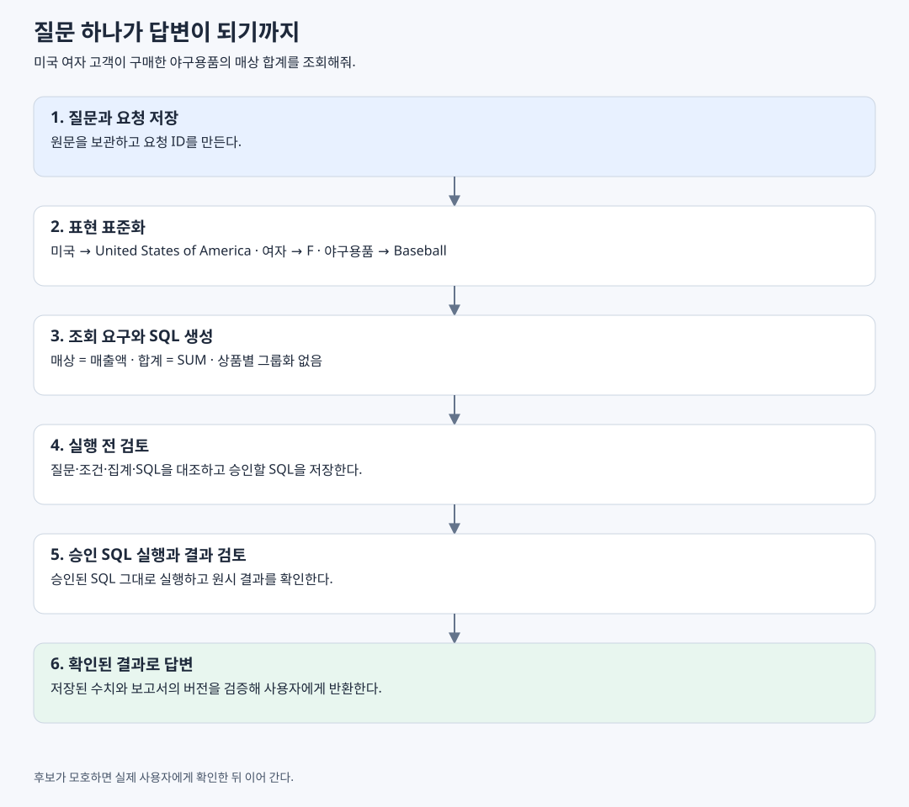
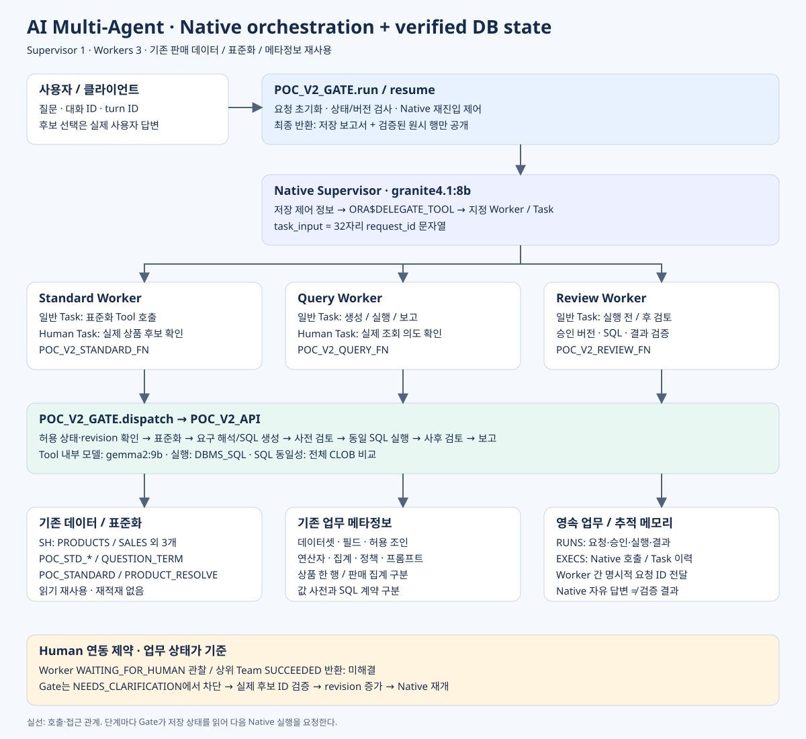

# AI 기반 자연어 데이터 조회 POC

이 POC는 사용자가 한국어로 질문하면 기존 판매 데이터를 조회하고, 확인된 결과를 한국어로 돌려주는 과정을 구현한다. Oracle AI Database의 Select AI Agent를 사용하며, 질문에 쓰인 업무 표현을 실제 데이터와 연결하기 위해 기존 표준화 사전과 메타정보를 함께 사용한다.

다음 질문을 예로 들어 구조와 동작을 살펴본다.

> 미국 여자 고객이 구매한 야구용품의 매상 합계를 조회해줘.

사용자는 국가명의 영문 표기, 성별 코드, 판매 테이블의 컬럼명을 몰라도 된다. 시스템은 질문의 의미를 확인하고 SQL을 생성한 뒤, 실행 전후 검토를 거쳐 답변한다.

## 1. 무엇을 확인하려는 POC인가

자연어를 SQL로 바꾸는 것만으로 업무 질문에 올바르게 답할 수 있는지는 판단하기 어렵다. “매상”이 어느 지표인지, “야구용품”이 어떤 분류값인지, 상품 목록과 판매 집계를 어떤 데이터에서 구해야 하는지까지 연결해야 한다. 같은 상품명에 여러 상품이 해당한다면 사용자의 선택도 필요하다.

이 POC의 목표는 이러한 과정을 역할별 AI Agent와 DB 프로그램으로 나누어 구현하고 검증하는 것이다. **질문을 데이터에 맞게 해석하는가, 검토한 SQL을 그대로 실행하는가, 실행 결과를 근거로 답변하는가**를 확인한다.

범위는 기존 SH의 상품·판매 데이터와 고객 성별·국가·상품분류·시간을 이용한 조회와 집계다. 기존 데이터와 표준화·메타정보를 재사용하며 재적재하지 않는다. 데이터 변경, 환율 변환, 임의 테이블 자동 개방은 포함하지 않는다.

## 2. 질문이 답변이 되는 과정

먼저 질문에 담긴 표현을 데이터 기준값과 업무 지표에 연결한다.

| 질문의 표현 | 연결할 의미 | 실제 데이터 또는 처리 |
|---|---|---|
| 미국 | 고객의 국가 | COUNTRY_NAME = 'United States of America' |
| 여자 고객 | 고객의 성별 | CUST_GENDER = 'F' |
| 야구용품 | 상품분류 | PROD_CATEGORY = 'Baseball' |
| 매상 | 매출액 지표 | SALES.AMOUNT_SOLD |
| 합계 | 전체 합산 | SUM, 상품별 그룹화 없음 |

그다음 판매 데이터에서 이 조건을 적용하는 SQL을 만든다. 별도의 검토 단계가 질문과 SQL을 대조하고, 승인된 SQL만 실행한다. 실행 후에는 결과의 형태를 다시 확인하고 저장된 수치로 답변한다.

여기서 중요한 것은 “야구용품”을 필터로 언급했다고 상품별 집계를 추가하지 않는다는 점이다. 질문은 조건에 해당하는 **전체 매상 합계 한 값**을 요구한다. 표현을 기준값에 연결하는 표준화와, 집계의 기준을 정하는 메타정보가 함께 필요한 이유다.

이 예시의 단계별 입력·출력과 비교 SQL은 [질문 하나 따라가기](./docs/QUESTION_TO_ANSWER.md)에서 설명한다.

## 3. 누가 어떤 일을 하는가

Supervisor 1개가 작업을 위임하고, 표준화·조회·검토 Worker 3개가 실제 도구를 호출한다.

**표준화 Worker**는 질문의 용어를 사전과 실제 상품에 연결한다. **조회 Worker**는 SQL 생성·실행·답변 작성을 담당한다. **검토 Worker**는 실행 전 SQL과 실행 후 결과를 확인한다. **Supervisor**는 이 Worker들에 작업을 위임한다.

DB의 진입 프로그램은 요청 상태를 저장하고 다음 작업을 제어한다. 따라서 모델이 “완료”라고 말해도 검토·실행 근거가 없으면 성공 답변을 반환하지 않는다. Worker들이 함께 사용하는 것은 암묵적인 대화 내용이 아니라 **요청 ID로 찾을 수 있는 저장 상태**다.

구체적인 Agent·Task·Tool의 관계와 사용자 확인 분기는 [구조와 역할](./docs/ARCHITECTURE.md)에 설명했다.

## 4. 어떤 데이터와 정보를 사용하는가

**원천 데이터**는 상품, 판매, 고객, 국가, 날짜의 다섯 테이블이다. 상품명·정가는 상품 기준정보에서, 매출액·판매수량은 판매 이력에서 구한다. 상품 목록을 판매 이력과 무조건 연결하면 같은 상품이 여러 번 나타날 수 있으므로 두 조회의 기준을 구분한다.

**표준화 사전**은 “미국” 같은 표현을 실제 DB 값에 연결한다. **업무 메타정보**는 매출액에 해당하는 컬럼, 가능한 집계, 필요한 조인, 데이터셋별 허용 필드를 설명한다.

**메모리**는 대화 이력과 저장된 업무 상태를 구분한다. 모델 대화 이력은 현재 작업의 문맥이고, DB에는 원문·확정 조건·SQL·승인·실행 결과를 보관한다. 재시도나 후보 선택 후 재개할 때는 이 저장 상태를 확인한다. 이전 질문의 “그중”을 자동으로 해석하는 대화형 분석은 이번 범위에 없다.

테이블 관계, 표준화 예시, 메타정보 및 메모리 설정은 [데이터와 메모리](./docs/DATA_AND_MEMORY.md)를 참고한다.

## 5. 직접 실행해보기

이미 POC가 배치된 LAB에서는 재설치하지 않고 질문 실행부터 시작한다. 처음 준비하는 환경은 기존 데이터·표준화 객체와 모델 연결을 확인한 뒤 설치해야 한다. 두 경우를 [실행 가이드](./docs/RUNBOOK.md)에서 나누어 안내한다.

~~~sql
SET LONG 200000
SET LONGCHUNKSIZE 200000

SELECT POC_V2_GATE.run(
 '미국 여자 고객이 구매한 야구용품의 매상 합계를 조회해줘.',
 'manual-20261124-01',
 'turn-001'
) AS response FROM dual;
~~~

응답이 succeeded이면 report와 result.rows를 확인한다. needs_human이면 실제 후보를 보여주고 사용자의 답변으로 재개한다. 새로운 질문에는 새로운 turn ID를 사용하고, 같은 요청의 재전송에는 같은 ID를 사용한다.

### 질문 예시 5개

1. **상품 확인:** 프로 메이플 배트의 상품 ID와 상품명과 정가를 조회해줘.
2. **판매 집계:** 미국 여자 고객이 구매한 야구용품의 매상 합계를 조회해줘.
3. **후보 확인:** Team shirt의 상품 ID와 상품명과 정가를 조회해줘.
4. **SQL 작성:** 미국 여자 고객이 구매한 야구용품의 매상 합계 SQL만 작성해줘. 실행하지 말아줘.
5. **SQL 설명:** 미국 여자 고객이 구매한 야구용품의 매상 합계 SQL을 설명해줘. 실행하지 말아줘.

3번은 이름이 같은 실제 상품 후보 중 하나를 선택하는 흐름이다. 4번과 5번은 데이터를 실행하지 않는 요청이다. 각 예시의 확인 방법과 검증 범위는 실행 가이드에 있다. [05_examples.sql](./05_examples.sql)에도 호출 예를 모았다.

## 6. 프로그램과 검증 결과 살펴보기

구현을 읽을 때는 [프로그램 설명](./docs/PROGRAMS.md)에서 설치 순서와 주요 패키지의 역할을 먼저 확인한다. SQL 파일에는 파일 목적과 함수별 설명 주석을 포함했다.

11월 20일 시험에서 상품 조회, 동일 조건의 판매 집계, 후보 선택 후 재개 API와 보호 검사 20개를 확인했다. 다만 Human Worker의 대기가 상위 Team 상태로 전달되지 않는 문제는 남아 있고, SQL 작성·설명 경로의 전체 Native 회귀 검증도 완료하지 않았다. 이번 개정에서는 질문 표현을 “미국”으로 정리했으며, 그 문장으로 DB 시험을 새로 실행하지 않았다.

실제 기준값, 통과·실패·미완료 항목과 시험 환경은 [검증 결과](./docs/VALIDATION.md)에 구분해 기록했다.

| 이어서 읽을 문서 | 내용 |
|---|---|
| [질문 하나 따라가기](./docs/QUESTION_TO_ANSWER.md) | 예제 질문의 표준화, 요구 해석, SQL, 검토, 답변까지. |
| [구조와 역할](./docs/ARCHITECTURE.md) | Supervisor·Worker·Tool과 DB 제어 계층. |
| [데이터와 메모리](./docs/DATA_AND_MEMORY.md) | 데이터 구조, 표준화, 메타정보, 영속 상태와 대화 이력. |
| [실행 가이드](./docs/RUNBOOK.md) | 기존 LAB 실행, 신규 설치, 질문 5개, 결과 대조. |
| [프로그램 설명](./docs/PROGRAMS.md) | SQL 파일별 목적과 주요 함수·설정. |
| [검증 결과](./docs/VALIDATION.md) | 실제 시험 결과와 남은 항목. |

[상위 Select AI Agent 문서](../README.md)
