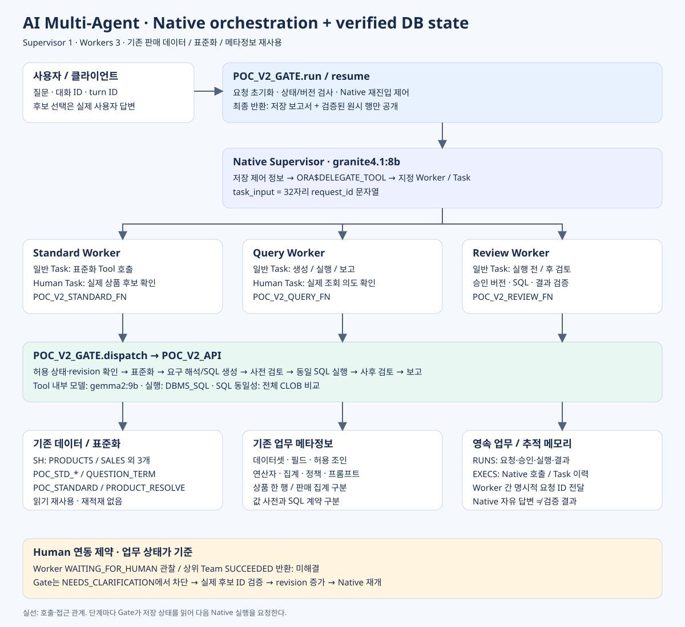

# 구조와 역할

[POC 소개](../README.md) · [질문 하나 따라가기](./QUESTION_TO_ANSWER.md)

## 역할을 나눈 이유

질문을 해석하고 SQL을 만드는 역할만 있으면, 잘못 해석한 요구가 그대로 실행과 답변까지 이어질 수 있다. 이 POC는 기준값을 확인하는 표준화, 조회를 수행하는 처리, 그 결과를 확인하는 검토를 분리했다. Supervisor는 작업을 각 Worker에 위임한다.

**Supervisor와 세 Worker는 Oracle Native Select AI Agent**다. 이 밖에 요청을 저장하고 허용된 순서를 검사하는 PL/SQL 진입 계층이 있다. AI가 작업을 수행하고 DB 코드가 그 작업의 상태·승인·반환 조건을 관리하는 구성이다.

## 구성 컴포넌트

표준화 Worker는 사용자의 표현을 사전과 실제 기준값에 연결한다. 상품명이 모호하면 실제 후보를 확인한다. 조회 Worker는 요구를 해석하고 SQL을 생성하며, 승인된 SQL 실행과 검토 완료 보고서 작성을 담당한다. 검토 Worker는 SQL 실행 전 질문과 쿼리를 대조하고, 실행 후 결과의 구조를 확인한다.

Worker가 사용하는 Tool은 PL/SQL 함수와 연결되어 있다. SQL 생성·검토에는 기존 업무 모델을 사용하고, 데이터 실행과 상태 검사는 DB 코드로 처리한다. 이번 구성에서 Native 조정 모델은 granite4.1:8b, Tool 내부 모델은 기존 gemma2:9b 프로파일이다.

| 개념 | 이 POC의 역할 | 구현 이름 |
|---|---|---|
| Supervisor | 지정 Worker에 작업 위임 | POC_V2_SUPERVISOR |
| 표준화 Worker | 기준값·상품 후보 확인 | POC_V2_STANDARD |
| 조회 Worker | 생성·실행·보고 | POC_V2_QUERY |
| 검토 Worker | 실행 전후 검토 | POC_V2_REVIEW |
| Tool 어댑터 | Worker의 도구 호출을 DB 처리로 연결 | STANDARD_FN / QUERY_FN / REVIEW_FN |
| 업무 처리 | 표준화·생성·검토·실행·보고의 실제 함수 | POC_V2_API |
| 공개 진입·제어 | 요청 초기화, 상태별 Native 호출, 최종 결과 검증 | POC_V2_GATE |

세 Worker에 일반 Task가 하나씩 있고, 표준화·조회 Worker에는 사용자 확인용 Human Task도 있다. Task는 총 5개지만 Worker는 3개다. Team은 sequential로 구성한다.

## 한 단계씩 이어 가는 방법

사용자가 Gate.run을 호출하면 Gate가 요청을 저장하고 현재 상태에서 필요한 Worker를 정한다. Native Supervisor에 Worker·Task 이름과 요청 ID를 전달하면 Supervisor가 Worker를 위임 호출한다. Worker가 Tool을 실행하면 DB 상태가 바뀐다. Gate는 이를 읽어 다음 Native 실행을 시작한다.

한 단계 위임은 모델에게 내리는 지시다. 모델이 언제나 한 번만 호출한다고 가정하지 않으므로, Tool이 현재 상태·버전·실행 여부를 검사해 중복 처리를 막는다. Worker에게는 제어 결과를 전달하고 사용자에게 보여줄 수치를 다시 쓰게 하지 않는다.

Gate는 SQL 계산을 직접 끝내는 대체 파이프라인을 실행하지 않는다. 업무 단계는 Native Worker가 Tool을 호출할 때 진행한다. 다만 Native가 반환한 완료 문장이 사용자 결과의 근거가 되지는 않는다. 최종 응답은 저장된 승인·실행·보고서를 코드에서 검증해 만든다.

## 사용자 확인과 재개

상품 후보가 여러 개이면 요청을 사용자 확인 상태로 남긴다. 실제 답변이 들어와야 후보 ID를 확인하고 요청 버전을 올려 계속한다. Worker가 사용자 답변을 발명해 저장하는 도구는 제공하지 않는다.

현재 LAB에서는 Human Worker가 WAITING_FOR_HUMAN인데 상위 Team은 SUCCEEDED로 반환되는 현상을 관찰했다. 따라서 Gate는 저장된 NEEDS_CLARIFICATION을 기준으로 SQL 생성을 차단한다. 재개 시 Native Team이 실제 대기 중이면 같은 실행 대화를 쓰고, 그렇지 않으면 새 실행 대화에서 저장 요청을 이어 간다. 상위 상태 문제는 미해결 항목으로 남긴다.

## 요청 상태와 실행 제한

정상 실행형 흐름은 다음과 같다. 실제 처리 중에는 생성 중·실행 중 상태도 사용한다.

~~~text
NEW → STANDARDIZED → SQL_GENERATED → PRECHECKED
    → EXECUTED → RESULT_REVIEWED → SUCCEEDED
~~~

SQL 작성·설명 요청은 실행과 사후 결과 검토를 건너뛰고 실행 없는 보고 경로로 간다. 재시도는 오류 상태, 정책과 예산이 허용하는 경우에만 수행한다. 상세 상태명과 한도는 [프로그램 설명](./PROGRAMS.md)의 부록에 모았다.
