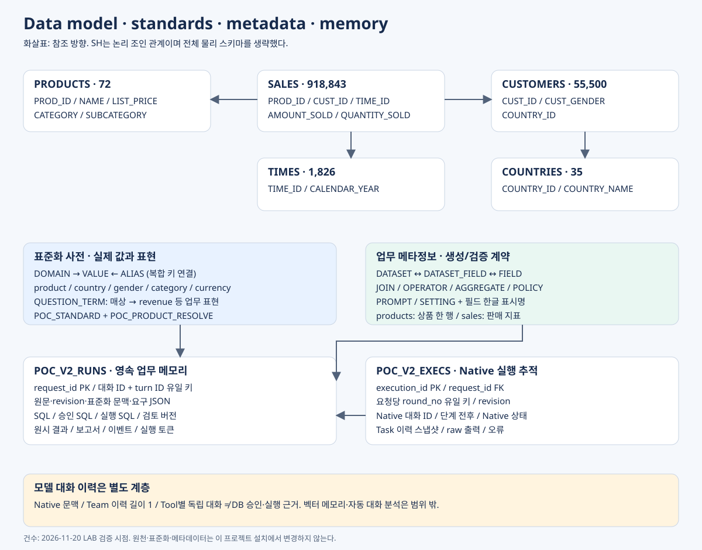

# 데이터·표준화·메타정보·메모리

[POC 소개](../README.md) · [질문 하나 따라가기](./QUESTION_TO_ANSWER.md)

## 1. 원천 데이터는 무엇인가

상품을 설명하는 기준정보와 실제 판매가 발생한 이력은 용도가 다르다. “상품 ID와 정가”는 상품 기준정보에서 찾고, “매상 합계”는 판매 이력에서 계산한다. 고객과 국가, 날짜는 판매 이력의 조건이나 집계 기준을 해석할 때 연결한다.

| 테이블 | 내용 | 주요 연결·사용 컬럼 | 검증 당시 행 수 |
|---|---|---|---:|
| PRODUCTS | 상품명·정가·분류 | PROD_ID, PROD_NAME, PROD_LIST_PRICE, PROD_CATEGORY, PROD_SUBCATEGORY | 72 |
| SALES | 판매금액·판매수량 | PROD_ID, CUST_ID, TIME_ID, AMOUNT_SOLD, QUANTITY_SOLD | 918,843 |
| CUSTOMERS | 고객 성별과 국가 | CUST_ID, CUST_GENDER, COUNTRY_ID | 55,500 |
| COUNTRIES | 국가 기준정보 | COUNTRY_ID, COUNTRY_NAME | 35 |
| TIMES | 날짜·연도 | TIME_ID, CALENDAR_YEAR | 1,826 |

상품과 판매는 PROD_ID, 판매와 고객은 CUST_ID, 고객과 국가는 COUNTRY_ID, 판매와 날짜는 TIME_ID로 연결한다. SALES 한 행을 상품 한 개나 주문 한 건과 동일시하지 않는다. 월별 집계는 연도를 포함한 YYYY-MM로 구분한다.

이 설치는 기존 LAB 객체를 읽어 사용한다. 데이터 재적재, 기존 사전 갱신은 수행하지 않는다. SH에는 통화 컬럼이 없으므로 USD는 POC 가정이며 환율 변환은 지원하지 않는다.

## 2. 표준화는 표현을 실제 값에 연결한다

사용자는 “미국”, DB는 United States of America라는 값을 사용할 수 있다. “여자”와 코드 F도 같은 방식이다. 표준화 사전은 이 연결을 보관한다. 상품은 이름 번역만으로 특정하지 않고 실제 상품 ID까지 연결한다.

| 사용자 표현 | 연결 결과 | 쓰임 |
|---|---|---|
| 미국 | United States of America | 국가 필터 |
| 여자 | F | 성별 필터 |
| 야구용품 | Baseball | 상품분류 필터 |
| 프로 메이플 배트 | 상품 ID 129 | 실제 상품 확인 |
| 매상 | revenue | 매출액 지표 해석 |

위 표에서 “매상”은 국가·성별처럼 DB 조건값에 연결되는 표현과 성격이 다르다. 업무 지표를 가리키는 용어이므로 질문 용어 정보로 관리한다.

표준화 사전은 영역, 기준값, 별칭으로 구성된다. 예를 들어 product 영역의 기준값은 상품 ID, 실제 DB 명칭, 한글명과 영문명을 구분해 저장한다. 한 기준값에 여러 별칭이 연결될 수 있고, 같은 영어명이 여러 상품에 연결될 수도 있다. 후자의 경우 실제 후보 중 하나를 사용자에게 확인한다.

기존 POC_STANDARD가 용어 정규화·질문 검색·표시명 처리를 담당한다. POC_PRODUCT_RESOLVE는 사전에서 찾은 상품 ID로 PRODUCTS의 실제 명칭과 정가를 읽는다.

## 3. 메타정보는 조회의 의미와 규칙을 설명한다

“매상”이 매출액이라는 것을 알아도 어느 컬럼을 더할지, 어떤 테이블을 연결할지, 무엇을 한 행으로 볼지는 더 알아야 한다. 메타정보는 AI와 검토 프로그램이 사용할 이 업무 정의를 제공한다.

데이터셋 정의는 상품 기준정보와 판매 분석을 나눈다. 필드 정의는 매출액을 SALES.AMOUNT_SOLD에 연결하고 가능한 집계와 필요한 조인을 설명한다. 데이터셋별 필드 소속은 상품 목록에서 판매 지표를 잘못 사용하는 것을 막는 검사에 쓰인다. 상품 고유 키는 상품당 한 행이라는 기준을 검토할 때 사용한다.

정책에는 조회·보고 행 수, 후보 수, 생성 재시도 같은 한도가 있다. 연산자·집계 정의와 한글 표시명도 기존 메타정보를 재사용한다. 다만 SQL 자체는 LLM이 생성하며, 모든 메타정보를 결정형 컴파일러로 변환하는 구조는 아니다. 주요 요구 추출·검토 프롬프트 일부는 PL/SQL 코드에 있다.

## 4. 메모리는 무엇을 기억하는가

이 POC에서 메모리를 말할 때는 **모델의 대화 이력**과 **DB의 업무 상태**를 구분해야 한다.

대화 이력은 지금 수행 중인 Native 작업을 이어 가는 문맥이다. Tool 내부의 요구 추출·SQL 생성·검토 호출은 각기 별도 대화를 만들고 명시적 문맥을 전달한다. 이전 모델 답변이 뒤 단계의 정답처럼 섞이는 일을 줄이기 위해서다.

DB의 업무 상태는 원문, 확정한 조건, 현재 SQL, 승인받은 SQL, 실제 실행한 SQL과 결과, 보고서를 보관한다. 재시도하거나 상품 선택 후 이어 갈 때는 이 상태가 기준이다. 승인은 특정 요청 버전과 SQL에 연결되므로 조건이 바뀌면 이전 승인을 무효화한다.

별도의 Native 실행 기록은 어떤 Worker가 호출됐고 어디서 멈췄는지 확인할 때 사용한다. 실행 추적 자료가 업무 승인 자체를 대신하지 않는다. 모델의 장기 이력 설정도 영구 지식 DB나 정답 캐시를 자동으로 만든다는 뜻이 아니다.

이번 범위에는 이전 질문의 “그중”, “같은 조건으로”를 자동 해석하는 분석 메모리나 벡터 메모리를 구현하지 않았다. 현재 자동 보존 기간·정리 작업도 없으므로 운영 전에는 질문·결과·실행 이력의 접근 권한과 보존 정책을 정해야 한다.

## 부록 A. 표준화·메타정보 테이블

아래 건수는 2026-11-20 LAB 기준이다. 이 13개 테이블은 시험 전후 내용 해시와 건수가 같았다. 별도 환경에서 필요한 기존 객체를 만드는 seed 스크립트는 이 폴더에 포함하지 않는다.

| 테이블 | 주요 키·정보 | 건수 |
|---|---|---:|
| POC_STD_DOMAIN | domain_key, field_key. product/gender/country/category/currency 영역 | 5 |
| POC_STD_VALUE | (domain_key,value_key), db_value, ko_name, en_name | 117 |
| POC_STD_ALIAS | (domain_key,value_key,alias_text), alias_norm, language, match_mode | 469 |
| POC_QUESTION_TERM | term_key, term_text, term_kind, target_key. 지표·집계·동작 표현 | 96 |
| POC_AI_DATASET | dataset_key, base_from, description, unique_key_field | 2 |
| POC_AI_FIELD | field_key, sql_expression, data_type, field_kind, allowed_aggs, default_agg, required_join, description, dictionary_managed, standard_domain, label_ko | 13 |
| POC_AI_DATASET_FIELD | (dataset_key,field_key). 데이터셋별 허용 필드 | 19 |
| POC_AI_JOIN | (dataset_key,join_key), join_sql | 4 |
| POC_AI_OPERATOR | operator_key, sql_token, arity, data_types | 11 |
| POC_AI_AGGREGATE | aggregate_key, sql_template, label_prefix | 5 |
| POC_AI_POLICY | policy_key, number_value | 9 |
| POC_PROMPT | prompt_key, prompt_text, description | 1 |
| POC_SETTING | setting_key, setting_value, description. 기존 프로파일·통화 가정 | 3 |

기존 통화 CROSS JOIN 정의는 v2 SQL 생성·검사 소스에서 제외하고 USD 리터럴 가정으로 다룬다. 원본 메타정보를 수정한 것은 아니다.

## 부록 B. 메모리의 구현 위치와 설정

| 위치 | 내용·설정 |
|---|---|
| POC_V2_RUNS | 요청 ID, 사용자 대화/turn, 원문·revision·문맥·요구·SQL·승인·실행·결과·보고서·이벤트 |
| POC_V2_EXECS | 요청 FK, round_no, Native 대화 ID·상태·Task 이력 스냅샷 |
| RUN_TEAM state_variables | request_id, request_revision을 Worker 도구에 전달 |
| instruction_variables | 실제 질문과 후보를 human_question으로 전달 |
| Native 프로파일·실행 대화 | conversation=true, conversation_length=30. Agent short_term_memory_length는 명시하지 않아 환경 기본값 사용 |
| Native Team | long_term_memory_length=1 |
| Tool 모델 호출 | 매번 별도 conversation_length=1 대화, 호출 뒤 기존 세션 대화 ID 복원 |

사용자 대화 ID와 Native 실행 대화 ID는 다르다. 하나의 요청에 여러 Native 대화가 연결될 수 있으며, 이들은 요청 ID로 업무 기록을 찾는다.
