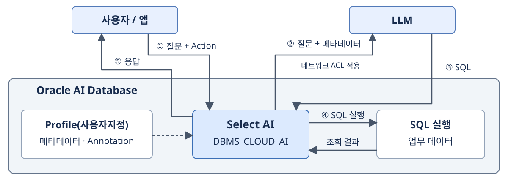
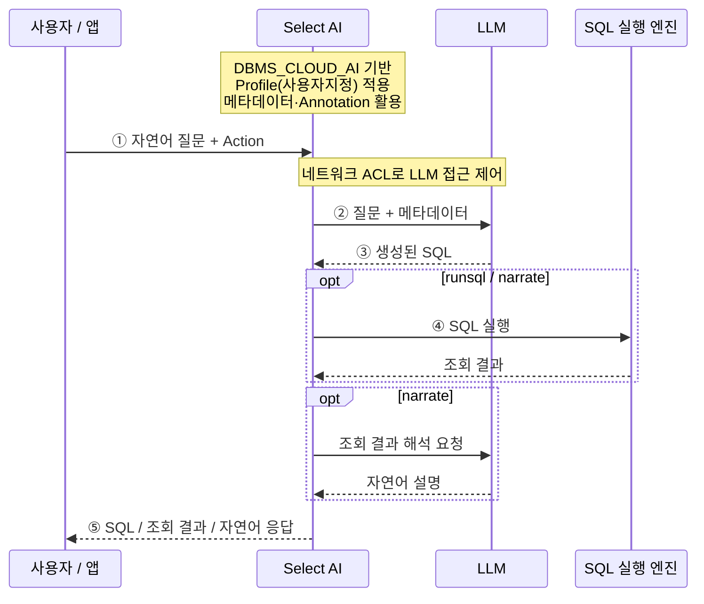

# Select AI 소개 및 실습

## Select AI란?

**Select AI는 NL2SQL(Natural Language to SQL)의 오라클 구현 프레임워크**로, LLM과 데이터베이스 메타데이터를 활용하여 자연어 질문을 SQL로 변환하고 데이터를 조회할 수 있도록 지원합니다.

주요 Action으로 SQL 생성·실행(`runsql`), SQL 확인(`showsql`), SQL 설명(`explainsql`), 조회 결과의 자연어 해석(`narrate`), LLM 대화(`chat`), 프롬프트 확인(`showprompt`)을 제공하며, 요약·번역·피드백·에이전트 실행으로 활용 범위를 확장합니다. [Oracle 공식 문서](https://docs.oracle.com/en/database/oracle/oracle-database/26/selai/use-ai-keyword-enter-prompts.html)

## SELECT AI 구조

다음은 NL2SQL을 중심으로 표현한 개념 구조입니다.



**Select AI**는 Profile(사용자지정)과 메타데이터를 활용해 LLM에 SQL 생성을 요청하고, **Action**에 따라 SQL을 보여주거나 실행 결과를 반환합니다. `narrate`는 조회 결과를 LLM에 다시 전달하여 자연어로 설명합니다.

그림에서는 간결한 표현을 위해 프로파일과 메타데이터를 하나의 박스로 묶었습니다. 프로파일은 처리 설정이며, 메타데이터·Annotation은 SQL 생성에 활용하는 데이터 구조와 업무 설명입니다.

- **DBMS_CLOUD_AI**: Select AI를 사용하기 위한 PL/SQL 패키지로, 프로파일 관리와 LLM 연동 등 주요 기능을 제공합니다.
- **Profile(사용자지정)**: 사용할 AI 제공자와 모델, 인증 정보 참조, 대상 테이블·뷰, 처리 옵션 등을 정의하는 설정입니다.
- **Annotation**: 테이블과 컬럼에 업무 의미나 속성을 부여하는 메타데이터입니다. Select AI가 이를 활용하도록 설정하면 LLM의 데이터 이해와 SQL 생성 정확도를 높이는 데 도움이 됩니다.
- **Action**: 자연어 요청을 어떻게 처리할지 지정하는 명령입니다. SQL 생성·실행(`runsql`), SQL 확인(`showsql`), 결과의 자연어 해석(`narrate`) 등이 있습니다.
- **네트워크 ACL**: 데이터베이스 사용자의 외부 LLM 엔드포인트 접근을 제어합니다.

## SELECT AI 처리 흐름



1. **질문 입력**: 사용자가 자연어 질문과 Action을 전달합니다.
2. **프롬프트 구성**: Select AI가 Profile(사용자지정)을 바탕으로 대상 객체의 메타데이터를 질문에 추가해 LLM에 전달합니다. 설정에 따라 Comments와 Annotations도 포함하여 업무 의미를 보완합니다.
3. **SQL 생성**: LLM이 질문과 메타데이터를 바탕으로 SQL을 생성해 반환합니다.
4. **SQL 실행**: `runsql`과 `narrate`는 생성된 SQL을 데이터베이스에서 실행합니다. `showsql`은 실행 없이 SQL을 반환합니다.
5. **응답 반환**: Action에 따라 SQL, 조회 결과 또는 자연어 설명을 제공합니다. `narrate`는 조회 결과를 LLM에 전달해 설명을 생성합니다.

Select AI와 SQL 실행 엔진은 Oracle AI Database 내부에 위치합니다. SQL 생성에는 스키마 메타데이터를 사용하며, `narrate`에서는 조회 결과도 LLM으로 전달됩니다.

## SELECT AI 실행 방법

세션에 Profile(사용자지정)을 설정한 후, 다음 구조로 실행합니다.

```sql
SELECT AI actions 자연어 질문;
```

- **SELECT AI**: 자연어 요청을 Select AI로 처리하도록 지정합니다.
- **actions**: 수행할 Action 하나를 지정하는 자리입니다. `runsql`, `showsql`, `explainsql`, `narrate` 등을 사용하며, 생략하면 `runsql`이 적용됩니다.
- **자연어 질문**: 조회하거나 분석할 내용을 자연어로 입력합니다.
- **;**: SQL 문장의 끝을 나타냅니다.

### actions 종류

`actions` 자리에는 다음 중 수행할 Action 하나를 입력합니다.

| Action | 간략한 설명 |
|---|---|
| `runsql` | SQL을 생성·실행하고 조회 결과를 반환합니다. 기본 Action입니다. |
| `showsql` | 생성된 SQL을 실행하지 않고 보여줍니다. |
| `explainsql` | 생성된 SQL의 동작을 자연어로 설명합니다. |
| `narrate` | 조회 결과를 자연어로 설명하거나, RAG 검색 내용을 바탕으로 답변합니다. |
| `chat` | LLM과 자연어로 대화합니다. |
| `showprompt` | NL2SQL 또는 RAG 처리 시 LLM에 전달할 프롬프트를 보여줍니다. |
| `summarize` | 입력한 텍스트를 요약합니다. |
| `feedback` | SQL 생성 정확도 개선을 위한 자연어 피드백을 제공합니다. |
| `translate` | OCI 번역 서비스를 이용해 지정한 언어로 번역합니다. |
| `agent` | 구성된 AI 에이전트 팀을 호출해 요청을 처리합니다. |

Action별 지원 여부와 필요한 프로파일 설정은 사용 환경에 따라 달라집니다. `feedback`은 Oracle AI Database 26ai에서 지원합니다. [Oracle 공식 문서](https://docs.oracle.com/en/database/oracle/oracle-database/26/selai/use-ai-keyword-enter-prompts.html)

## SELECT AI 프로파일

**Profile(사용자지정)**은 Select AI가 사용할 LLM, 인증 정보 참조, 대상 객체와 처리 옵션을 모아 놓은 설정입니다. `DBMS_CLOUD_AI.CREATE_PROFILE`로 생성하고, `DBMS_CLOUD_AI.SET_PROFILE`로 현재 세션에 적용합니다. [Oracle 공식 문서](https://docs.oracle.com/en/database/oracle/oracle-database/26/selai/manage-ai-profiles.html)

### 프로파일 구조

프로파일은 **이름(`profile_name`), 설정(`attributes`), 상태(`status`), 설명(`description`)**으로 구성됩니다. 실제 처리 설정은 `attributes`에 JSON 형식으로 지정합니다.

다음은 구조를 보여주는 예시로, `<...>`는 사용 환경에 맞는 값으로 변경합니다.

```sql
BEGIN
  DBMS_CLOUD_AI.CREATE_PROFILE(
    profile_name => 'SELECTAI_PROFILE',
    attributes   => '{
      "provider": "<AI 제공자>",
      "provider_endpoint": "<AI 제공자 API 엔드포인트>",
      "credential_name": "<등록된 Credential 이름>",
      "model": "<모델 이름>",
      "object_list": [
        {"owner": "<스키마 이름>", "name": "<테이블 또는 뷰 이름>"}
      ],
      "comments": true,
      "annotations": true,
      "constraints": true
    }',
    status       => 'ENABLED',
    description  => 'Select AI 실습용 프로파일'
  );
END;
/
```

`profile_name`은 프로파일 식별자이고, `attributes`는 LLM 연동과 SQL 생성 방식을 정합니다. `status`와 `description`은 선택 항목이며, 상태를 생략하면 기본으로 활성화됩니다. 생성된 프로파일의 활성화 상태와 현재 세션에서 사용할 프로파일 지정은 별개입니다.

### 주요 attributes

| 구분 | Attribute | 간략한 설명 |
|---|---|---|
| LLM 연동 | `provider` | 사용할 AI 제공자입니다. |
| LLM 연동 | `model` | 사용할 모델 이름입니다. |
| LLM 연동 | `credential_name` | AI 제공자 인증에 사용할 등록된 Credential 이름입니다. Ollama 같은 온프레미스 LLM을 인증 없는 엔드포인트로 연동하는 구성에서는 생략할 수 있습니다. |
| LLM 연동 | `provider_endpoint` | AI 제공자의 API 엔드포인트입니다. |
| 대상 객체 | `object_list` | 메타데이터를 활용할 객체 목록입니다. `owner`와 `name`으로 지정합니다. |
| 대상 객체 | `object_list_mode` | 전체 객체의 메타데이터(`all`) 또는 질문과 관련된 객체의 메타데이터(`automated`)를 전달합니다. |
| 대상 객체 | `enforce_object_list` | 생성 SQL이 `object_list`의 객체만 사용하도록 제한할지 지정합니다. DB 접근 권한을 부여하는 설정은 아닙니다. |
| 메타데이터 | `comments` | 테이블·컬럼의 Comment를 프롬프트에 포함할지 지정합니다. 기본값은 `false`이며, 포함하려면 `true`로 설정합니다. |
| 메타데이터 | `annotations` | 테이블·컬럼의 Annotation을 포함합니다. 기본값은 `false`입니다. |
| 메타데이터 | `constraints` | PK·FK 등 참조 무결성 제약조건을 포함합니다. 기본값은 `false`입니다. |
| SQL 생성 | `case_sensitive_values` | 문자열 값 비교 시 대소문자를 구분하도록 LLM에 지시할지 설정합니다. 기본값은 `false`이며, 대소문자를 구분하지 않도록 지시합니다. |
| 응답 생성 | `temperature` | 응답 생성의 무작위성을 조절합니다. 낮을수록 변동성이 줄어듭니다. |
| 응답 생성 | `max_tokens` | 생성할 응답의 최대 토큰 수입니다. |
| 응답 생성 | `seed` | 반복 요청의 결과 변동성을 줄이기 위한 시드입니다. 동일한 결과를 보장하지는 않습니다. |
| 대화 | `conversation`, `conversation_length` | 대화 이력 사용 여부와 유지 길이를 설정합니다. |
| RAG | `embedding_model`, `vector_index_name` | 임베딩 모델과 사용할 벡터 인덱스를 지정합니다. |

이 외에 제공자별로 `region`, `oci_compartment_id`, `oci_endpoint_id`, `oci_apiformat`, `azure_resource_name`, `azure_deployment_name` 등을 사용합니다. 지원 속성과 필수 항목은 DB 버전·서비스·AI 제공자에 따라 확인합니다. Annotation의 활용 방법은 뒤에서 다룹니다. [Oracle Profile Attributes 공식 문서](https://docs.oracle.com/en/cloud/paas/autonomous-database/serverless/adbsb/dbms-cloud-ai-package.html)

`comments` 기본값 참고: [Oracle Select AI 공식 Java API 자료](https://docs.oracle.com/en/cloud/paas/autonomous-database/serverless/saija/src-html/com/oracle/database/selectai/model/ProfileAttributes.Builder.html)

Ollama의 Credential 생략 구성 참고: [Oracle Select AI와 프라이빗 Ollama 연동 가이드(PDF)](https://adwc4pm.objectstorage.us-ashburn-1.oci.customer-oci.com/n/adwc4pm/b/OML-Resources/o/SelectAI-Ollama-PrivateEndpoint.pdf#page=20)

참고: [Select AI 개요](https://docs.oracle.com/en/database/oracle/oracle-database/26/selai/select-ai-about.html), [AI 프로파일](https://docs.oracle.com/en/database/oracle/oracle-database/26/selai/manage-ai-profiles.html), [메타데이터와 Annotation](https://docs.oracle.com/en/database/oracle/oracle-database/26/selai/data-and-metadata-concepts.html), [Action별 동작](https://docs.oracle.com/en/database/oracle/oracle-database/26/selai/use-ai-keyword-enter-prompts.html)

네트워크 접근 제어 참고: [DBMS_NETWORK_ACL_ADMIN](https://docs.oracle.com/en/database/oracle/oracle-database/26/arpls/DBMS_NETWORK_ACL_ADMIN.html)
