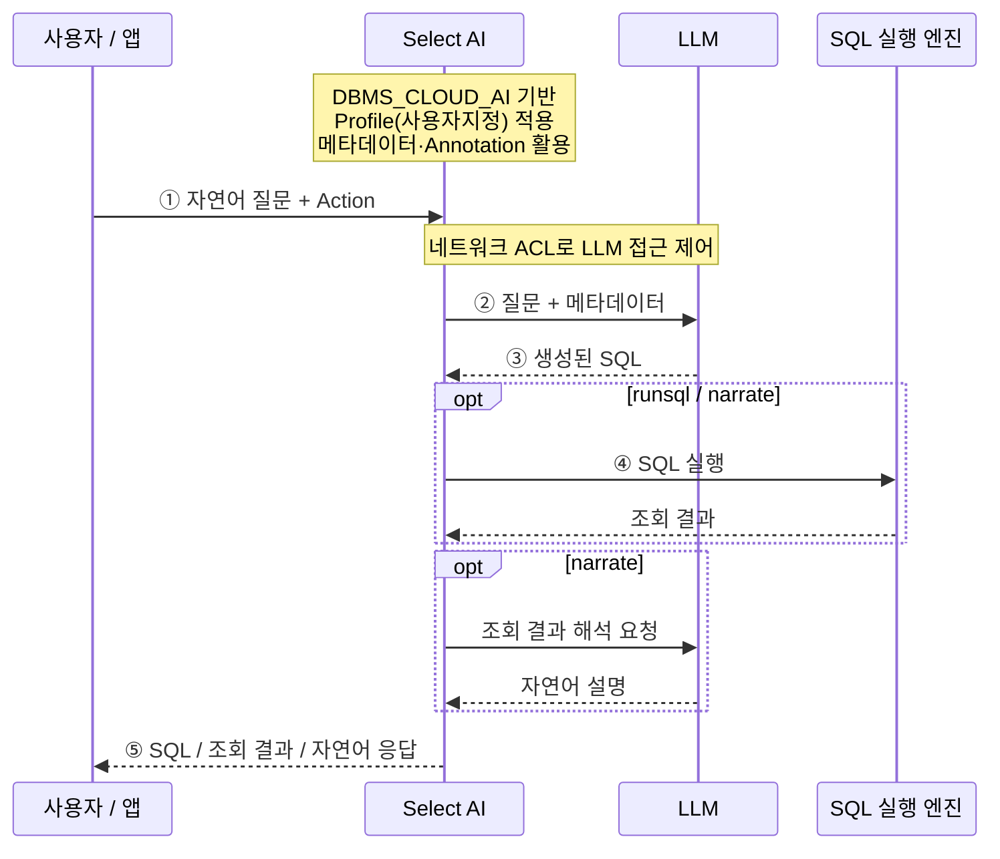

# Select AI 소개 및 실습

## Select AI란?

**Select AI는 NL2SQL(Natural Language to SQL)의 오라클 구현 프레임워크**로, LLM과 데이터베이스 메타데이터를 활용하여 자연어 질문을 SQL로 변환하고 데이터를 조회할 수 있도록 지원합니다.

주요 Action으로 SQL 생성·실행(`runsql`), SQL 확인(`showsql`), SQL 설명(`explainsql`), 조회 결과의 자연어 해석(`narrate`), LLM 대화(`chat`), 프롬프트 확인(`showprompt`)을 제공하며, 요약·번역·피드백·에이전트 실행으로 활용 범위를 확장합니다. [Oracle 공식 문서](https://docs.oracle.com/en/database/oracle/oracle-database/26/selai/use-ai-keyword-enter-prompts.html)

## SELECT AI 구조

다음은 NL2SQL을 중심으로 표현한 개념 구조입니다.

**Select AI**는 Profile(사용자지정)과 메타데이터를 활용해 LLM에 SQL 생성을 요청하고, **Action**에 따라 SQL을 보여주거나 실행 결과를 반환합니다. `narrate`는 조회 결과를 LLM에 다시 전달하여 자연어로 설명합니다.

그림에서는 간결한 표현을 위해 프로파일과 메타데이터를 하나의 박스로 묶었습니다. 프로파일은 처리 설정이며, 메타데이터·Annotation은 SQL 생성에 활용하는 데이터 구조와 업무 설명입니다.

- **DBMS_CLOUD_AI**: Select AI를 사용하기 위한 PL/SQL 패키지로, 프로파일 관리와 LLM 연동 등 주요 기능을 제공합니다.
- **Profile(사용자지정)**: 사용할 AI 제공자와 모델, 인증 정보 참조, 대상 테이블·뷰, 처리 옵션 등을 정의하는 설정입니다.
- **Annotation**: 테이블과 컬럼에 업무 의미나 속성을 부여하는 메타데이터입니다. Select AI가 이를 활용하도록 설정하면 LLM의 데이터 이해와 SQL 생성 정확도를 높이는 데 도움이 됩니다.
- **Action**: 자연어 요청을 어떻게 처리할지 지정하는 명령입니다. SQL 생성·실행(`runsql`), SQL 확인(`showsql`), 결과의 자연어 해석(`narrate`) 등이 있습니다.
- **네트워크 ACL**: 데이터베이스 사용자의 외부 LLM 엔드포인트 접근을 제어합니다.

## SELECT AI 처리 흐름

1. **질문 입력**: 사용자가 자연어 질문과 Action을 전달합니다.
2. **프롬프트 구성**: Select AI가 Profile(사용자지정)을 바탕으로 대상 객체의 메타데이터를 질문에 추가해 LLM에 전달합니다. 설정에 따라 Comments와 Annotations도 포함하여 업무 의미를 보완합니다.
3. **SQL 생성**: LLM이 질문과 메타데이터를 바탕으로 SQL을 생성해 반환합니다.
4. **SQL 실행**: `runsql`과 `narrate`는 생성된 SQL을 데이터베이스에서 실행합니다. `showsql`은 실행 없이 SQL을 반환합니다.
5. **응답 반환**: Action에 따라 SQL, 조회 결과 또는 자연어 설명을 제공합니다. `narrate`는 조회 결과를 LLM에 전달해 설명을 생성합니다.

Select AI와 SQL 실행 엔진은 Oracle AI Database 내부에 위치합니다. SQL 생성에는 스키마 메타데이터를 사용하며, `narrate`에서는 조회 결과도 LLM으로 전달됩니다.

참고: [Select AI 개요](https://docs.oracle.com/en/database/oracle/oracle-database/26/selai/select-ai-about.html), [AI 프로파일](https://docs.oracle.com/en/database/oracle/oracle-database/26/selai/manage-ai-profiles.html), [메타데이터와 Annotation](https://docs.oracle.com/en/database/oracle/oracle-database/26/selai/data-and-metadata-concepts.html), [Action별 동작](https://docs.oracle.com/en/database/oracle/oracle-database/26/selai/use-ai-keyword-enter-prompts.html)

네트워크 접근 제어 참고: [DBMS_NETWORK_ACL_ADMIN](https://docs.oracle.com/en/database/oracle/oracle-database/26/arpls/DBMS_NETWORK_ACL_ADMIN.html)
