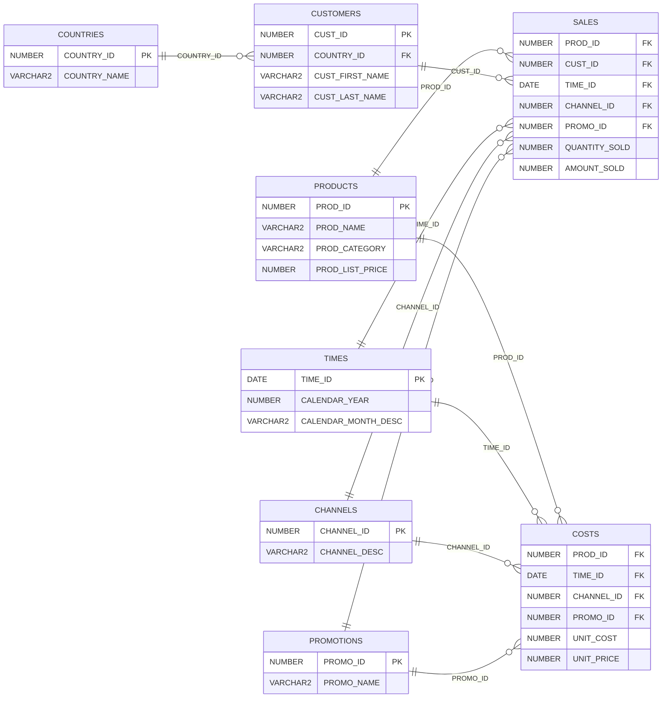

# SELECT AI 예제

## 예제 개요

이 예제는 **Annotation을 활용하여 자연어 질문에서 생성되는 SQL의 정확도를 높이는 방법**을 실습합니다. Annotation에 테이블·컬럼의 업무 의미와 해석에 필요한 정보를 제공하고, 적용 전후의 생성 SQL과 조회 결과를 비교합니다.

| 항목 | 내용 |
|---|---|
| 실습 데이터 | Oracle 샘플 `SH`(Sales History) 스키마의 `PRODUCTS` 테이블 |
| 실습 계정 | `lab00` |
| 비교 방식 | 동일한 데이터와 자연어 질문을 사용하여 Annotation 적용 전후 비교 |
| 확인 항목 | 테이블·컬럼 선택, 조인 관계, 조건과 집계의 정확성 |

예제 스크립트는 이 문서의 SQL 코드 블록에 직접 작성합니다.

## 실습 데이터: SH.PRODUCTS

`SH.PRODUCTS`는 Oracle의 판매 이력 샘플 스키마에서 **상품 기준정보**를 관리하는 테이블입니다. 상품별로 한 행을 저장하며, 기본키는 `PROD_ID`입니다. 상품명·설명, 대분류·소분류, 가격, 공급자와 상태 등의 정보를 포함합니다.

### 테이블 관계 구조도

기본 실습 대상은 `PRODUCTS`입니다. 다음은 관계 이해를 위해 판매·원가·고객 등 SH의 주요 테이블과 연결 키를 함께 표시한 구조도입니다. 각 테이블에는 주요 컬럼만 표시했습니다.



`PK`는 기본키, `FK`는 외래키입니다. 관계선은 부모 테이블의 한 행에 자식 테이블의 여러 행이 연결될 수 있음을 나타냅니다.

`SALES`는 판매금액·수량, `COSTS`는 단위 원가·가격을 관리합니다. 상품·일자·채널·프로모션을 기준으로 연결되며, `SALES`는 고객 정보와도 연결됩니다. 고객의 국가는 `CUSTOMERS`를 통해 확인합니다.

### 주요 데이터 구조

| 구분 | 주요 컬럼 | 내용 |
|---|---|---|
| 상품 식별 | `PROD_ID`, `PROD_NAME`, `PROD_DESC` | 상품 ID, 상품명, 상세 설명 |
| 상품 분류 | `PROD_CATEGORY`, `PROD_SUBCATEGORY` | 상품 대분류와 소분류 |
| 분류 부가정보 | `PROD_CATEGORY_ID`, `PROD_SUBCATEGORY_ID`, `PROD_CATEGORY_DESC`, `PROD_SUBCATEGORY_DESC` | 분류별 ID와 설명 |
| 가격 | `PROD_LIST_PRICE`, `PROD_MIN_PRICE` | 상품 정가와 최저 가격 |
| 공급자·상태 | `SUPPLIER_ID`, `PROD_STATUS` | 공급자 ID와 상품 상태 |
| 상품 속성 | `PROD_WEIGHT_CLASS`, `PROD_UNIT_OF_MEASURE`, `PROD_PACK_SIZE` | 중량 등급, 측정 단위, 포장 크기 |
| 이력 관리 | `PROD_SRC_ID`, `PROD_EFF_FROM`, `PROD_EFF_TO`, `PROD_VALID` | 원본 식별자, 유효기간, 유효성 표시 |

### 데이터 내용과 활용

현재 Oracle 공개 샘플에는 야구용품 등의 상품이 포함됩니다. 예를 들어 상품 `129`는 `Pro Maple Bat`이며, 대분류는 `Baseball`, 소분류는 `Bats`, 정가는 `192.99`입니다. 데이터를 직접 조회하여 확인하십시오.

이 데이터를 이용해 **분류별 상품 수, 상품 가격 비교, 조건에 맞는 상품 검색**을 실습합니다. 특히 한국어 질문의 “상품명”, “대분류”, “정가” 같은 표현을 해당 컬럼에 연결하도록 Annotation으로 업무 의미를 보완할 수 있습니다.

`PRODUCTS`의 가격은 상품 기준정보이며, 실제 판매금액과 판매수량은 `SH.SALES`에서 관리합니다. 두 테이블은 `PROD_ID`로 연결됩니다.

참고: [Oracle SH 테이블 정의](https://docs.oracle.com/en/database/oracle/oracle-database/26/comsc/SH-sample-schema-table-descriptions.html), [공식 테이블 생성 스크립트](https://github.com/oracle-samples/db-sample-schemas/blob/main/sales_history/sh_create.sql), [공식 샘플 데이터](https://github.com/oracle-samples/db-sample-schemas/blob/main/sales_history/sh_populate.sql)

## 질문 예제

첫 번째 질문은 기본 비교용이며, 나머지는 업무 용어의 정의가 SQL에 반영되는지 확인하는 질문입니다. 아래 업무 정의는 **이 실습에서 정한 규칙**입니다.

| 번호 | 자연어 질문 | Part 2에서 Annotation으로 제공할 업무 정의 |
|---|---|---|
| 1 | 상품 대분류별 상품 수를 많은 순서로 보여줘. | 대분류는 `PROD_CATEGORY`입니다. 기본 비교용 질문입니다. |
| 2 | 야구용품 중 고가 상품의 상품명과 정가를 보여줘. | 야구용품은 `PROD_CATEGORY = 'Baseball'`, 고가 상품은 `PROD_LIST_PRICE >= 100`입니다. |
| 3 | 가격 조정 여지가 있는 상품을 보여줘. | 가격 조정 여지가 있는 상품은 `PROD_LIST_PRICE > PROD_MIN_PRICE`인 상품입니다. |
| 4 | 가격 인하 가능액이 큰 상위 5개 상품을 보여줘. | 가격 인하 가능액은 `PROD_LIST_PRICE - PROD_MIN_PRICE`입니다. 내림차순으로 5개를 선택하며, 동률이면 `PROD_ID` 오름차순을 적용합니다. |
| 5 | 소분류별 가격 인하 가능률의 평균을 보여줘. | 소분류는 `PROD_SUBCATEGORY`, 가격 인하 가능률은 `(PROD_LIST_PRICE - PROD_MIN_PRICE) / PROD_LIST_PRICE * 100`입니다. 정가가 0인 상품은 계산에서 제외하고, 상품별 비율의 평균을 구합니다. |

두 파트에서는 **표의 자연어 질문을 동일하게 사용**합니다. Part 1에서는 업무 정의를 프롬프트에 추가하지 않고, Part 2에서는 업무 정의를 Annotation으로 제공합니다. SQL이 실행되는지뿐 아니라 **정해진 업무 규칙에 맞는 조건·계산식·집계를 생성하는지**를 비교합니다.

## 실행 전 확인

[SELECT AI 실습환경 구성](SelectAiCongigure.md)의 관리자 설정과 데이터 준비를 먼저 완료합니다. 이후 스크립트는 SQL*Plus 또는 SQLcl에서 **대상 PDB에 `lab00`으로 접속한 세션**에서 실행합니다.

### ACL 확인

Ollama 호스트는 구성 문서에서 등록한 값과 동일하게 지정합니다. `USER_HOST_ACES`에서 현재 계정의 호스트 접근 권한을 확인합니다. CDB의 서비스 계정 ACL은 구성 문서에 따라 관리자가 확인합니다.

```sql
DEFINE OLLAMA_HOST = service-ollama

SELECT host, lower_port, upper_port, privilege
FROM   user_host_aces
WHERE  host = '&&OLLAMA_HOST'
ORDER BY privilege;
```

예시 구성에서는 `http`, `connect`, `resolve` 권한이 표시되어야 합니다. 이 조회는 ACL 확인이며, 실제 Ollama 서비스의 실행 상태와 모델 응답까지 확인하는 것은 아닙니다.

### 데이터 확인

실습 대상은 `SH.PRODUCTS`에서 복사한 `LAB00.PRODUCTS`입니다. 대상 테이블의 행 수와 주요 컬럼 값을 확인합니다.

```sql
SELECT USER AS current_user,
       SYS_CONTEXT('USERENV', 'CON_NAME') AS current_pdb
FROM dual;

SELECT COUNT(*) AS product_count
FROM products;

SELECT prod_id, prod_name, prod_category, prod_subcategory,
       prod_list_price, prod_min_price
FROM products
ORDER BY prod_id
FETCH FIRST 5 ROWS ONLY;
```

## Part 1. Annotation을 사용하지 않는 예제

Annotation을 사용하지 않은 상태에서 자연어 질문으로 SQL을 생성·실행합니다. 생성된 SQL과 기대 결과를 비교하여 업무 의미가 충분히 반영되는지 확인합니다.

### 프로파일 생성과 적용: SELECTAI_PRODUCTS_NOANN

Ollama 엔드포인트와 모델명을 실제 환경에 맞게 변경합니다. 인증 없는 Ollama 프록시 구성이므로 `credential_name`은 지정하지 않습니다. `/v1` 경로는 [참조 문서](../SelectAI/SelectAI_Config_Run.md)의 23.26.2 구성을 기준으로 하며, 설치 버전과 프록시 구성에 맞게 조정합니다.

Part 1 프로파일은 `annotations=false`로 설정하여 Annotation을 SQL 생성에 사용하지 않습니다.

```sql
DEFINE OLLAMA_ENDPOINT = http://service-ollama/v1
DEFINE OLLAMA_MODEL = gemma2:9b

BEGIN
  DBMS_CLOUD_AI.CREATE_PROFILE(
    profile_name => 'SELECTAI_PRODUCTS_NOANN',
    attributes   => '{
      "provider_endpoint": "&&OLLAMA_ENDPOINT",
      "model": "&&OLLAMA_MODEL",
      "object_list": [
        {"owner": "LAB00", "name": "PRODUCTS"}
      ],
      "comments": false,
      "annotations": false,
      "constraints": true,
      "enforce_object_list": true,
      "conversation": false,
      "max_tokens": 1024,
      "temperature": 0,
      "seed": 42
    }',
    status      => 'enabled',
    description => 'Part 1: Annotation을 사용하지 않는 PRODUCTS 실습'
  );
END;
/

EXEC DBMS_CLOUD_AI.SET_PROFILE('SELECTAI_PRODUCTS_NOANN');

SELECT DBMS_CLOUD_AI.GET_PROFILE() AS current_profile
FROM dual;
```

## Part 2. Annotation을 사용하는 예제

테이블·컬럼에 업무 정의를 담은 Annotation을 추가하고, `annotations=true`인 별도 프로파일을 사용합니다. Part 1과 동일한 질문을 실행하여 **업무 의미를 보완한 Annotation이 SQL 작성의 정확도 향상에 어떤 도움을 주는지** 확인합니다.

### 프로파일 생성과 적용: SELECTAI_PRODUCTS_ANN

Part 2 프로파일은 `annotations=true`로 설정합니다. 아래 프로파일 생성은 Annotation 자체를 추가하지 않으므로, 업무 정의에 대한 Annotation을 `LAB00.PRODUCTS`에 추가한 상태에서 질문을 실행합니다. 엔드포인트와 모델은 Part 1과 동일하게 지정합니다.

```sql
DEFINE OLLAMA_ENDPOINT = http://service-ollama/v1
DEFINE OLLAMA_MODEL = gemma2:9b

BEGIN
  DBMS_CLOUD_AI.CREATE_PROFILE(
    profile_name => 'SELECTAI_PRODUCTS_ANN',
    attributes   => '{
      "provider_endpoint": "&&OLLAMA_ENDPOINT",
      "model": "&&OLLAMA_MODEL",
      "object_list": [
        {"owner": "LAB00", "name": "PRODUCTS"}
      ],
      "comments": false,
      "annotations": true,
      "constraints": true,
      "enforce_object_list": true,
      "conversation": false,
      "max_tokens": 1024,
      "temperature": 0,
      "seed": 42
    }',
    status      => 'enabled',
    description => 'Part 2: Annotation을 사용하는 PRODUCTS 실습'
  );
END;
/

EXEC DBMS_CLOUD_AI.SET_PROFILE('SELECTAI_PRODUCTS_ANN');

SELECT DBMS_CLOUD_AI.GET_PROFILE() AS current_profile
FROM dual;
```

프로파일 이름과 `annotations` 값을 제외한 LLM·대상 객체·처리 옵션은 두 파트에서 동일하게 유지합니다. `comments=false`와 `conversation=false`도 유지하여 Comment와 이전 대화의 영향을 줄입니다. `comments`와 `annotations`는 각각 별도 옵션입니다. [Oracle 공식 문서](https://docs.oracle.com/en/database/oracle/oracle-database/26/selai/generate-and-improve-sql-queries.html)

동일 이름의 프로파일이 이미 있으면 생성 구문은 오류가 발생합니다. 기존 설정을 확인한 뒤 필요한 속성을 변경합니다. 새 DB 세션으로 접속할 때는 해당 Part의 `SET_PROFILE`을 다시 실행합니다.

생성 SQL은 기대 SQL 및 조회 결과와 함께 검증합니다.
