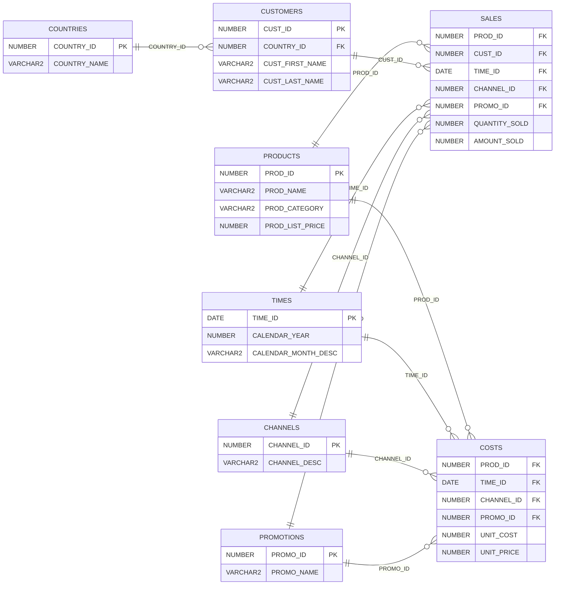

# SELECT AI 예제

## 예제 개요

이 예제는 **Annotation을 활용하여 자연어 질문에서 생성되는 SQL의 정확도를 높이는 방법**을 실습합니다. Annotation에 테이블·컬럼의 업무 의미와 해석에 필요한 정보를 제공하고, 적용 전후의 생성 SQL과 조회 결과를 비교합니다.

| 항목 | 내용 |
|---|---|
| 실습 데이터 | Oracle 샘플 `SH`(Sales History) 스키마의 `PRODUCTS` 테이블 |
| 실습 계정 | `lab00` |
| 비교 방식 | 동일한 데이터와 자연어 질문을 사용하여 Annotation 적용 전후 비교 |
| 확인 항목 | 테이블·컬럼 선택, 조인 관계, 조건과 집계의 정확성 |

예제 스크립트는 이 문서의 SQL 코드 블록에 직접 작성합니다.

## 실습 데이터: SH.PRODUCTS

`SH.PRODUCTS`는 Oracle의 판매 이력 샘플 스키마에서 **상품 기준정보**를 관리하는 테이블입니다. 상품별로 한 행을 저장하며, 기본키는 `PROD_ID`입니다. 상품명·설명, 대분류·소분류, 가격, 공급자와 상태 등의 정보를 포함합니다.

### 테이블 관계 구조도

기본 실습 대상은 `PRODUCTS`입니다. 다음은 관계 이해를 위해 판매·원가·고객 등 SH의 주요 테이블과 연결 키를 함께 표시한 구조도입니다. 각 테이블에는 주요 컬럼만 표시했습니다.

`PK`는 기본키, `FK`는 외래키입니다. 관계선은 부모 테이블의 한 행에 자식 테이블의 여러 행이 연결될 수 있음을 나타냅니다.

`SALES`는 판매금액·수량, `COSTS`는 단위 원가·가격을 관리합니다. 상품·일자·채널·프로모션을 기준으로 연결되며, `SALES`는 고객 정보와도 연결됩니다. 고객의 국가는 `CUSTOMERS`를 통해 확인합니다.

### 주요 데이터 구조

| 구분 | 주요 컬럼 | 내용 |
|---|---|---|
| 상품 식별 | `PROD_ID`, `PROD_NAME`, `PROD_DESC` | 상품 ID, 상품명, 상세 설명 |
| 상품 분류 | `PROD_CATEGORY`, `PROD_SUBCATEGORY` | 상품 대분류와 소분류 |
| 분류 부가정보 | `PROD_CATEGORY_ID`, `PROD_SUBCATEGORY_ID`, `PROD_CATEGORY_DESC`, `PROD_SUBCATEGORY_DESC` | 분류별 ID와 설명 |
| 가격 | `PROD_LIST_PRICE`, `PROD_MIN_PRICE` | 상품 정가와 최저 가격 |
| 공급자·상태 | `SUPPLIER_ID`, `PROD_STATUS` | 공급자 ID와 상품 상태 |
| 상품 속성 | `PROD_WEIGHT_CLASS`, `PROD_UNIT_OF_MEASURE`, `PROD_PACK_SIZE` | 중량 등급, 측정 단위, 포장 크기 |
| 이력 관리 | `PROD_SRC_ID`, `PROD_EFF_FROM`, `PROD_EFF_TO`, `PROD_VALID` | 원본 식별자, 유효기간, 유효성 표시 |

### 데이터 내용과 활용

현재 Oracle 공개 샘플에는 야구용품 등의 상품이 포함됩니다. 예를 들어 상품 `129`는 `Pro Maple Bat`이며, 대분류는 `Baseball`, 소분류는 `Bats`, 정가는 `192.99`입니다. 데이터를 직접 조회하여 확인하십시오.

이 데이터를 이용해 **분류별 상품 수, 상품 가격 비교, 조건에 맞는 상품 검색**을 실습합니다. 특히 한국어 질문의 “상품명”, “대분류”, “정가” 같은 표현을 해당 컬럼에 연결하도록 Annotation으로 업무 의미를 보완할 수 있습니다.

`PRODUCTS`의 가격은 상품 기준정보이며, 실제 판매금액과 판매수량은 `SH.SALES`에서 관리합니다. 두 테이블은 `PROD_ID`로 연결됩니다.

참고: [Oracle SH 테이블 정의](https://docs.oracle.com/en/database/oracle/oracle-database/26/comsc/SH-sample-schema-table-descriptions.html), [공식 테이블 생성 스크립트](https://github.com/oracle-samples/db-sample-schemas/blob/main/sales_history/sh_create.sql), [공식 샘플 데이터](https://github.com/oracle-samples/db-sample-schemas/blob/main/sales_history/sh_populate.sql)

## 질문 예제

1. 상품 대분류별 상품 수를 구하고, 상품 수가 많은 순서로 보여줘.
2. 야구(Baseball) 대분류에 속한 상품의 상품명, 소분류, 정가를 정가가 높은 순서로 보여줘.
3. 상품 정가가 100 이상인 상품 중 정가가 가장 높은 5개의 상품명과 정가를 보여줘. 정가가 같으면 상품 ID가 작은 순서로 골라줘.
4. 상품 소분류별 평균 정가와 평균 최저 가격을 구하고, 평균 정가가 높은 순서로 보여줘.
5. 정가가 최저 가격보다 높은 상품의 상품명, 정가, 최저 가격과 두 가격의 차이를 구하고, 가격 차이가 큰 순서로 보여줘.

## Part 1. Annotation을 사용하지 않는 예제

Annotation을 사용하지 않은 상태에서 자연어 질문으로 SQL을 생성·실행합니다. 생성된 SQL과 기대 결과를 비교하여 업무 의미가 충분히 반영되는지 확인합니다.

## Part 2. Annotation을 사용하는 예제

테이블·컬럼에 Annotation을 추가하고, 프로파일의 `annotations`를 `true`로 설정하여 SQL 생성에 활용합니다. Part 1과 동일한 질문을 실행하여 **업무 의미를 보완한 Annotation이 SQL 작성의 정확도 향상에 어떤 도움을 주는지** 확인합니다.

두 파트에서는 가능한 한 다른 설정을 동일하게 유지하여 Annotation 적용에 따른 차이를 비교합니다. 생성 SQL은 기대 SQL 및 조회 결과와 함께 검증합니다.
