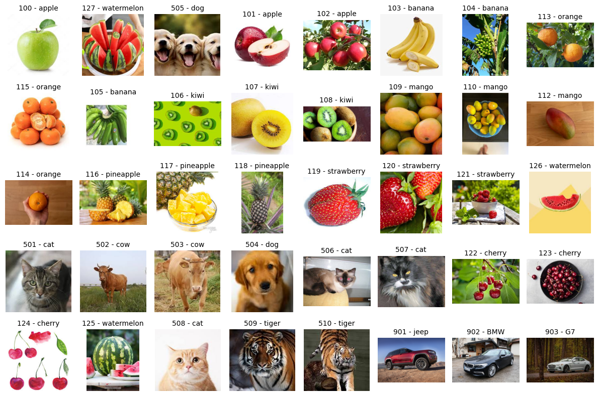
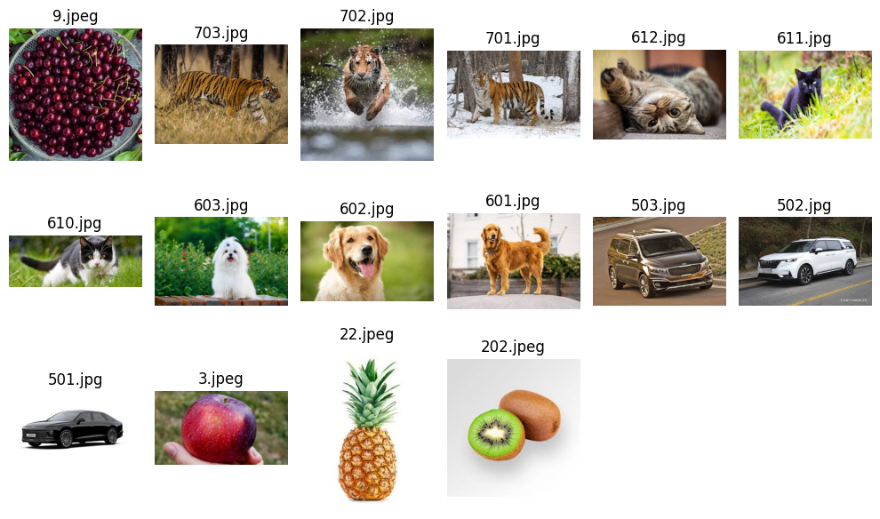
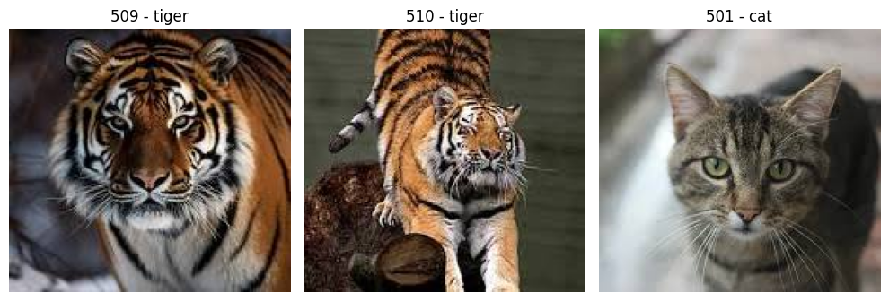
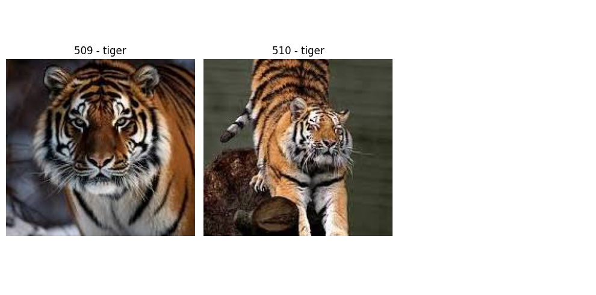

# 이미지–이미지·텍스트–이미지 검색

같은 CLIP 모델 계열의 이미지 인코더와 텍스트 인코더를 사용해 서로 다른 입력을 공통 벡터 공간에서 비교합니다. 저장 이미지를 임베딩한 뒤 입력 이미지 또는 설명 문장과 가까운 이미지를 찾습니다.

## 실습 전 준비

IMG_TBL 테이블과 data/images의 이미지, 검증용 data/images/val_data, CLIP_VIT_LARGE_PATCH14_IMG·CLIP_VIT_LARGE_PATCH14_TXT 모델이 필요합니다. 두 모델은 같은 CLIP 체크포인트와 호환되는 전처리로 준비합니다.

[공통 환경과 데이터 준비](00.Setup.md)를 먼저 진행합니다. 아래 Python 블록은 같은 세션에서 위에서 아래로 실행하며, 작업 디렉터리는 similarity_search입니다. 코드 블록 자체는 Markdown 화면에서 실행되지 않습니다.

## 처리 흐름

저장 이미지 → CLIP 이미지 인코더 → IMG_V ← 거리 비교 ← 입력 이미지 / 텍스트의 CLIP 임베딩

### 1.파이썬 라이브러리 로딩 및 DB 접속

Python은 DB 연결과 이미지 표시를 담당하고 임베딩은 DB의 ONNX 모델로 생성합니다. BLOB과 VECTOR 바인딩을 지원하는 python-oracledb 환경을 사용합니다.

```python
import os
from getpass import getpass
# Oracle AI Database 접속 및 라이브러리 로딩
import oracledb
import pandas as pd
from user_functions import display, read_lob
from user_functions import get_conn_cursor, get_db_version, exec_sql,exec_sql_rows, dml_sql, ddl_sql, img_show

import os, io
from PIL import Image
import matplotlib.pyplot as plt
import math

# DB 접속
user_id = os.getenv("ORACLE_USER") or input("DB 사용자: ")
pwd = os.getenv("ORACLE_PASSWORD") or getpass("DB 비밀번호: ")
dbconn = os.getenv("ORACLE_DSN") or input("DB DSN (호스트:포트/PDB서비스): ")

conn, cursor = get_conn_cursor(user_id,pwd,dbconn)

# DB 버전 확인
display(get_db_version(cursor))
```

### 2. 임베딩 모델 확인
- 실제 사용 모델은 CLIP_VIT_LARGE_PATCH14_IMG·CLIP_VIT_LARGE_PATCH14_TXT이며, 동일한 CLIP 체크포인트에서 변환해 DB에 적재합니다.

실제 코드에서 사용하는 모델은 CLIP_VIT_LARGE_PATCH14_IMG와 CLIP_VIT_LARGE_PATCH14_TXT입니다. 원본 설명의 VIT_BASE_PATCH16_224 모델명과 구분합니다.

```python
# DB관리중인 ONNX 모델 조회
managed_models = """
SELECT MODEL_NAME, MINING_FUNCTION, ALGORITHM, ALGORITHM_TYPE, (MODEL_SIZE/1024/1024) MB
FROM user_mining_models
ORDER BY MODEL_NAME"""
print("DB관리중인 ONNX 모델")
exec_sql(cursor,managed_models)
```

### 3. 테이블의 이미지 파일 확인
이미지 저장 테이블 : img_tbl(imgno, img_category, img, img_v)

DB에 저장된 BLOB 이미지를 읽어 범주와 함께 표시합니다. Python 클라이언트가 원본 DB 파일 경로에 접근할 필요는 없습니다.

```python
# 이미지 데이터 조회
img_info = """
SELECT imgno, img_category_detail, img
           FROM img_tbl
           """
rows = exec_sql_rows(cursor,img_info)

images = []
titles = []

for imgno, category, blob in rows:
    if blob:
        try:
            img_bytes = blob.read()
            img = Image.open(io.BytesIO(img_bytes))
            images.append(img)
            titles.append(f"{imgno} - {category}")
        except Exception as e:
            print(f"IMGNO {imgno} 오류: {e}")
    else:
        print(f"IMGNO {imgno}는 이미지가 없습니다.")

# 8x5 그리드 디스플레이

print("테이블 이미지 정보")
fig, axes = plt.subplots(5, 8, figsize=(12,8))

for i in range(40):
    ax = axes[i // 8, i % 8]
    if i < len(images):
        ax.imshow(images[i])
        ax.set_title(titles[i], fontsize=10)
    ax.axis('off')

plt.tight_layout()
plt.show()
```

원본 노트북의 출력 예시(재실행 결과 아님):



### 4.벡터 컬럼 초기화 및 임베딩 저장

다음 UPDATE는 기존 이미지 임베딩을 초기화하고 커밋합니다. 처음 적재하거나 다시 임베딩할 때만 수행합니다.

```python
# 임베딩 데이터 초기화
clean_v = """update img_tbl set img_v = NULL"""
dml_sql(conn,cursor,clean_v)
img_info = """select imgno, img_v from img_tbl fetch first 5 rows only"""
print(" 이미지 정보")
exec_sql(cursor,img_info)
```

이미지 모델로 생성한 벡터를 IMGNO 기준으로 저장합니다. UPDATE 바인드는 위치 방식과 이름 방식을 섞지 않고 이름으로 통일했습니다.

```python
# 데이터 임베딩
# convert to vector using 벡터 험수(vector_embedding)
# 이미지 임베딩 모델 : CLIP_VIT_LARGE_PATCH14_IMG

print("임베딩 처리 & 데이터 저장중입니다.....")

img_q = """select imgno,
           vector_embedding(CLIP_VIT_LARGE_PATCH14_IMG using img as DATA)
           from img_tbl order by imgno
        """
imgnos = exec_sql_rows(cursor,img_q)

# 이미지 별로 벡터 임베딩 데이터를 벡터 컬럼값으로 저장
for row in imgnos:
    imgno = row[0]
    embedding = row[1]
    # UPDATE 쿼리 실행
    cursor.execute("""
        UPDATE img_tbl
        SET img_v = :embedding
        WHERE imgno = :imgno
    """, {"embedding": embedding, "imgno": imgno})
    #print(f"imgno {imgno} updated.")
conn.commit()
print("embedding & saving complete!")
```

### 5.검증(입력)용 데이터 확인

이 단계의 ./data 경로는 DB 서버가 아니라 Python 실행 위치를 기준으로 합니다. similarity_search 디렉터리에서 실행합니다.

```python
# 디렉토리의 이미지 확인
import os
from PIL import Image
import matplotlib.pyplot as plt
import math

# 이미지가 있는 디렉토리 경로

print("테스트용 샘플 이미지")
img_dir = "./data/images/val_data"
img_files = [f for f in os.listdir(img_dir) if f.lower().endswith(('.png', '.jpg', '.jpeg', '.gif'))]

cols = 6
rows = math.ceil(len(img_files) / cols)

fig, axes = plt.subplots(rows, cols, figsize=(10, 2 * rows))

for i, ax in enumerate(axes.flat):
    if i < len(img_files):
        img_path = os.path.join(img_dir, img_files[i])
        img = Image.open(img_path)
        ax.imshow(img)
        ax.set_title(img_files[i], fontsize=12)
    ax.axis('off')

plt.tight_layout()
plt.show()
```

원본 노트북의 출력 예시(재실행 결과 아님):



### 6. 유사 이미지 검색(이미지 to 이미지)

입력 파일을 BLOB 바인드로 전달해 이미지 임베딩을 얻고, 저장 벡터와의 COSINE 거리를 비교합니다. 입력 이미지와 DB 이미지에 같은 인코더를 사용합니다.

```python
import os
from PIL import Image
import matplotlib.pyplot as plt
from oracledb import DB_TYPE_BLOB

img_dir = "./data/images/val_data/"
img_file = input("입력 이미지 파일명 입력 :")
img_path = os.path.join(img_dir, img_file)

# 입력 이미지 화면 표시
img_show(img_path)

# 입력 이미지 임베딩
with open(img_path, 'rb') as f:
    img = f.read()
blob = cursor.var(DB_TYPE_BLOB)
blob.setvalue(0, img)

data = cursor.execute("select vector_embedding(CLIP_VIT_LARGE_PATCH14_IMG using :1 as DATA) from dual", [blob])
img_embed = data.fetchone()

# 테이블 이미지에서 입력 이미지와 유사한 이미지 검색(벡터 검색)

# 이미지 벡터 쿼리
img_vq = """
select imgno,img_category_detail, img from img_tbl
order by vector_distance(img_v, :1,cosine)
fetch first 3 rows only
"""
result = exec_sql_rows(cursor,img_vq,img_embed)

# 이미지 벡터 검색 결과 출력

r_images = []
r_titles = []

for imgno, category, blob in result:
    if blob:
        try:
            img_bytes = blob.read()
            img = Image.open(io.BytesIO(img_bytes))
            r_images.append(img)
            r_titles.append(f"{imgno} - {category}")
        except Exception as e:
            print(f"IMGNO {imgno} 오류: {e}")
    else:
        print(f"IMGNO {imgno}는 이미지가 없습니다.")

# 1*3 그리드 디스플레이
print("벡터 검색 결과")

fig, axes = plt.subplots(1, 3, figsize=(10, 5))

for i in range(3):
    ax = axes[i]
    if i < len(r_images):
        ax.imshow(r_images[i])
        ax.set_title(r_titles[i], fontsize=12)
    ax.axis('off')

plt.tight_layout()
plt.show()
```

원본 노트북의 출력 예시(재실행 결과 아님):


원본 노트북의 출력 예시(재실행 결과 아님):



### 7. 유사 이미지 검색(텍스트 to 이미지)
- 텍스트를 입력하면 의미를 입력하여 입력 텍스트와 유사한 이미지를 검색합니다

텍스트는 CLIP 텍스트 인코더로 변환합니다. 이미지와 벡터 차원이 같다는 것만으로 비교 가능한 것은 아니며, 공통 CLIP 모델 계열이어야 합니다. 영어·한국어 설명의 검색 품질은 사용 모델로 직접 비교합니다.

```python
import os
from PIL import Image
import matplotlib.pyplot as plt
from oracledb import DB_TYPE_BLOB

txt2img = input("찾고 싶은 이미지 입력 :")  #예 : cutted fruits

data = cursor.execute("select vector_embedding(CLIP_VIT_LARGE_PATCH14_TXT using :1 as DATA) from dual", [txt2img])
img_embed = data.fetchone()

# 테이블 이미지에서 입력 입력 텍스트와 의미가 유사한 이미지 검색(벡터 검색)

# 텍스트 이미지 벡터 쿼리
img_vq = """
select imgno,img_category_detail, img from img_tbl
order by vector_distance(img_v, :1,cosine)
fetch first 2 rows only
"""
result = exec_sql_rows(cursor,img_vq,img_embed)

# 텍스트 이미지 벡터 검색 결과 출력

r_images = []
r_titles = []

for imgno, category, blob in result:
    if blob:
        try:
            img_bytes = blob.read()
            img = Image.open(io.BytesIO(img_bytes))
            r_images.append(img)
            r_titles.append(f"{imgno} - {category}")
        except Exception as e:
            print(f"IMGNO {imgno} 오류: {e}")
    else:
        print(f"IMGNO {imgno}는 이미지가 없습니다.")

# 1*3 그리드 디스플레이
print("벡터 검색 결과")

fig, axes = plt.subplots(1, 3, figsize=(10, 5))

for i in range(3):
    ax = axes[i]
    if i < len(r_images):
        ax.imshow(r_images[i])
        ax.set_title(r_titles[i], fontsize=12)
    ax.axis('off')

plt.tight_layout()
plt.show()
```

원본 노트북의 출력 예시(재실행 결과 아님):



## 연결 정리

```python
cursor.close()
conn.close()
```

## 결과 확인

- 이미지–이미지와 텍스트–이미지의 상위 결과를 각각 확인합니다.
- 이 예제는 FETCH FIRST를 사용하는 정확 검색이며 별도 이미지 벡터 인덱스를 만들지 않습니다.
- 아래 보존 이미지는 원본 노트북의 과거 출력입니다. 이번 문서 변환에서 DB를 재실행해 생성한 결과는 아닙니다.

## 참고 문서

- [Oracle CLIP 멀티모달 임베딩](https://docs.oracle.com/en/database/oracle/oracle-database/26/vecse/generate-multi-modal-embeddings-using-clip.html)
- [python-oracledb VECTOR 바인딩](https://python-oracledb.readthedocs.io/en/latest/user_guide/vector_data_type.html)

[전체 실습 안내](readme.md) · [공통 함수 설명](user_functions.md)
